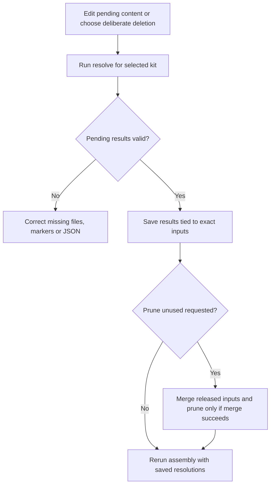
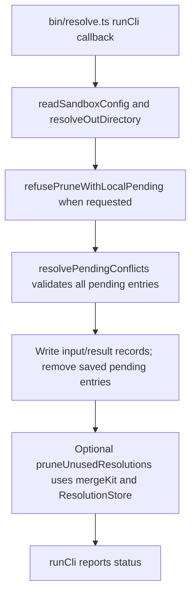

# US-OPS-03 — Resolve a pending assembly conflict

As a sandbox maintainer, I want to record edited conflict results for their exact input blobs so that future assembly can reuse the reviewed resolution.

**Status:** Operator; source-reviewed availability, not runtime-tested.
**Access:** Sandbox maintainer with the selected kit sources, supported Node 24/pnpm toolchain and filesystem access.
**Entry:** `pnpm resolve --kit <kit> [--pending <dir>] [--delete <path>]... [--prune-unused]`.
**Documentation:** [Repository instructions](../../docs/specification.md).
**Source:** [Resolve CLI](../../bin/resolve.ts).

## Acceptance criteria

| Option           | Type          | Required/default/conditions                                                                                         |
| ---------------- | ------------- | ------------------------------------------------------------------------------------------------------------------- |
| `--kit`          | String        | Required; configured kit                                                                                            |
| `--pending`      | Directory     | Defaults to `tmp/conflicts`; resolved folder must be inside repository `tmp/`                                       |
| `--delete`       | Repeated path | Optional; each path must identify a pending conflict and records intentional deletion                               |
| `--prune-unused` | Boolean       | Defaults false; requires the default pending location and merges released sources before pruning unused resolutions |

- Edit pending result files before invoking the command. Missing content, remaining conflict markers or a non-object `package.json` result reject validation before any pending result is saved.
- `resolvePendingConflicts` records content/deletion beside base/ours/theirs blob and mode inputs, retaining alternative resolutions for different inputs. Successfully saved pending files are removed.
- Optional unused pruning runs after saves; if its released merge fails it reports nothing pruned and exits nonzero, while already saved resolutions remain.
- Rerun assembly to establish that the intended resolution matches and the resulting app is usable; saving a resolution alone does not test the app.

## User flow

## Code flow

Scope: Sandbox CLI through its implementation; generated application behavior is outside this operation.

**Code references:** [Resolve CLI](../../bin/resolve.ts), [resolvePendingConflicts and ResolutionStore](../../src/resolutions.ts), [Pruning helpers](../../src/resolve_command.ts), [Resolution tests](../../tests/tooling/merge.spec.ts).
