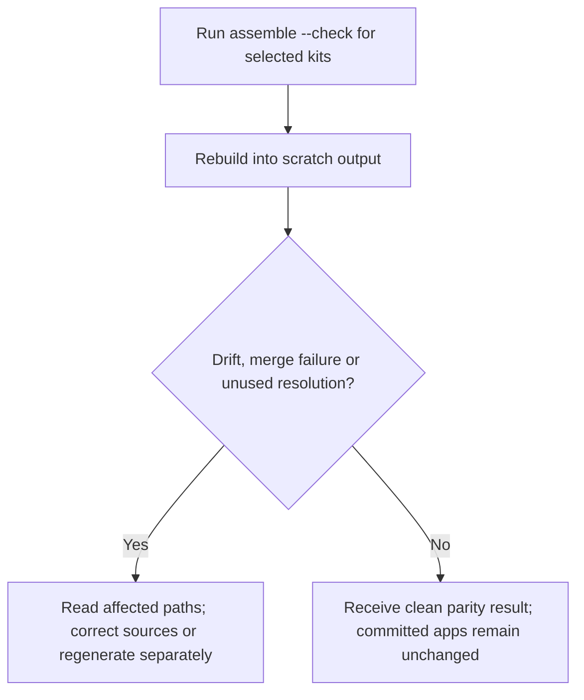
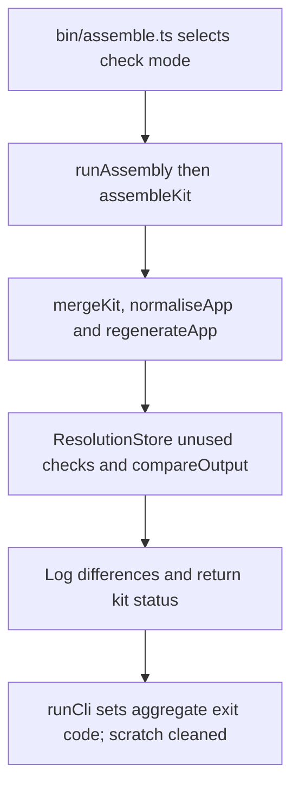

# US-OPS-04 — Check committed apps match assembly

As a sandbox maintainer, I want to compare regenerated kits with committed apps so that I can detect drift without replacing those app trees.

**Status:** Operator; source-reviewed availability, not runtime-tested.
**Access:** Sandbox maintainer with the selected kit sources, supported Node 24/pnpm toolchain and filesystem access.
**Entry:** `pnpm assemble --check [--kit <kit>]...`.
**Documentation:** [Repository instructions](../../docs/specification.md).
**Source:** [Assembly CLI](../../bin/assemble.ts).

## Acceptance criteria

- With no `--kit`, check all configured kits; repeated `--kit` selects a subset. Source configuration and network/cache prerequisites are the same as released assembly.
- Check mode cannot combine with `--with-local` or main mode. It regenerates into scratch output, uses the existing lockfile frozen, and compares output paths, bytes and modes with `apps/<kit>`.
- Differences or unused resolutions make the result nonzero; applicable alternative-version resolutions are noted separately. Committed app trees are not replaced by this command.
- Each selected kit is attempted. A clean comparison establishes source/output parity, not successful runtime journeys.

## User flow

## Code flow

Scope: Sandbox CLI through its implementation; generated application behavior is outside this operation.

**Code references:** [Assembly CLI](../../bin/assemble.ts), [Check path](../../src/assembly.ts), [compareOutput](../../src/compare.ts), [Assembly tests](../../tests/tooling/assembly.spec.ts).
