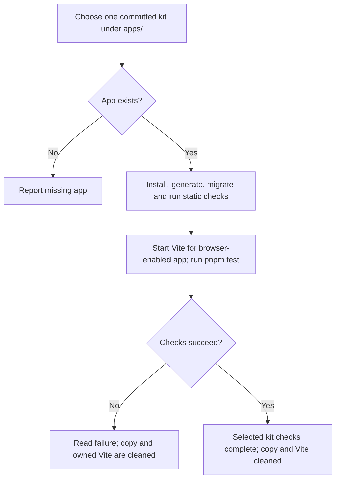
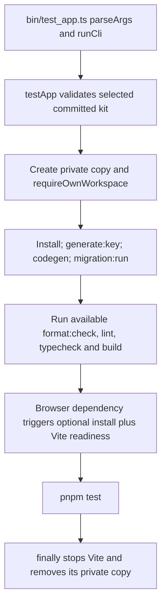

# US-OPS-05 — Test one committed app

As an app maintainer, I want to check one selected committed app in a disposable copy so that I can assess that kit without modifying its app tree.

**Status:** Operator; source-reviewed availability, not runtime-tested.
**Access:** App maintainer with the selected committed app, supported Node 24/pnpm toolchain and filesystem access.
**Entry:** `pnpm test:app --kit NAME [--install-browsers]`.
**Documentation:** [Run an app](../../README.md#run-an-app).
**Source:** [Test CLI](../../bin/test_app.ts).

## Acceptance criteria

| Option               | Type    | Required/default/conditions                                                                                                  |
| -------------------- | ------- | ---------------------------------------------------------------------------------------------------------------------------- |
| `--kit`              | String  | Required; one of the four supported kits                                                                                     |
| `--install-browsers` | Boolean | Defaults false; installs Chromium with dependencies only for browser-enabled apps; does not select or suppress browser tests |

- `testApp` copies the selected `apps/<kit>` app without `node_modules` into a private directory under `tmp/test-app/`, installs dependencies, copies environment defaults, generates key/code, migrates, and runs available formatting/lint/types/build scripts followed by `pnpm test`.
- If the app has `@japa/browser-client`, it starts Vite on `127.0.0.1:5173` and waits up to 30 seconds for that child to answer before tests. An occupied port fails the browser check. Browser binaries must already exist unless installation is requested; omit the flag only to skip installation, not browser testing.
- Missing app or failed setup/check/test reports failure.
- The command stops its Vite process and removes its disposable copy in `finally`; it covers only the selected kit. This catalogue did not run the command.

## User flow

## Code flow

Scope: App test CLI through its implementation; the command's result covers only the selected app.

**Code references:** [Test CLI](../../bin/test_app.ts), [testApp](../../src/app_test.ts), [App test specifications](../../tests/tooling/app_test.spec.ts).
