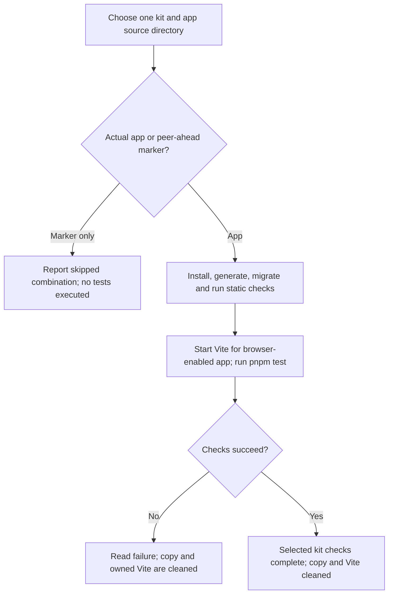
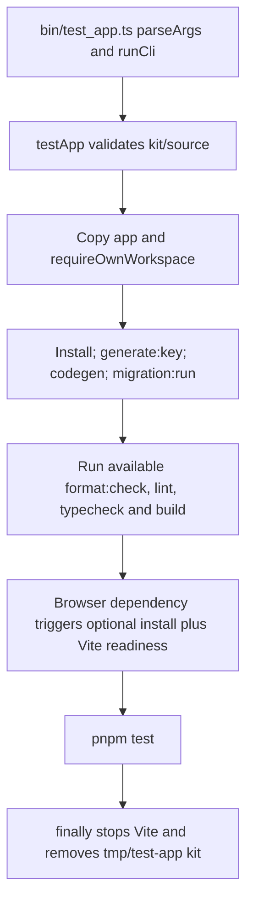

# US-OPS-05 — Test one assembled kit

As a sandbox maintainer, I want to check one selected generated app in a disposable copy so that I can assess that kit without modifying its committed app tree.

**Status:** Operator; source-reviewed availability, not runtime-tested.
**Access:** Sandbox maintainer with the selected kit sources, supported Node 24/pnpm toolchain and filesystem access.
**Entry:** `pnpm test:app --kit <kit> [--dir <directory>] [--install-browsers]`.
**Documentation:** [Repository instructions](../../docs/specification.md).
**Source:** [Test CLI](../../bin/test_app.ts).

## Acceptance criteria

| Option               | Type      | Required/default/conditions                                                                                                  |
| -------------------- | --------- | ---------------------------------------------------------------------------------------------------------------------------- |
| `--kit`              | String    | Required; one of the four supported kits                                                                                     |
| `--dir`              | Directory | Optional; defaults `apps`; selected source is `<directory>/<kit>`                                                            |
| `--install-browsers` | Boolean   | Defaults false; installs Chromium with dependencies only for browser-enabled apps; does not select or suppress browser tests |

- `testApp` copies the selected app without node_modules under `tmp/test-app/<kit>`, installs dependencies, copies environment defaults, generates key/code, migrates, and runs available formatting/lint/types/build scripts followed by `pnpm test`.
- If the app has `@japa/browser-client`, it starts Vite on `127.0.0.1:5173` and waits for readiness before tests. Browser binaries must already exist unless installation is requested; omit the flag only to skip installation, not browser testing.
- A peer-ahead marker without a package manifest is reported and returns without app tests. Missing app or failed setup/check/test reports failure; no claim of executed tests follows from a skipped marker.
- The command stops its Vite process and removes its disposable copy in `finally`; it covers only the selected kit. This catalogue did not run the command.

## User flow

## Code flow

Scope: Sandbox CLI through its implementation; generated application behavior is outside this operation.

**Code references:** [Test CLI](../../bin/test_app.ts), [testApp](../../src/app_test.ts), [App test specifications](../../tests/tooling/app_test.spec.ts).
