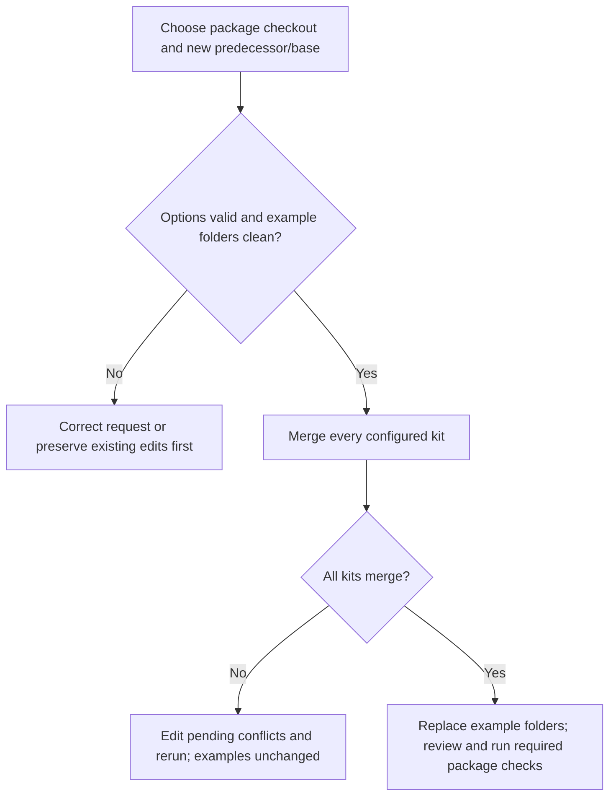
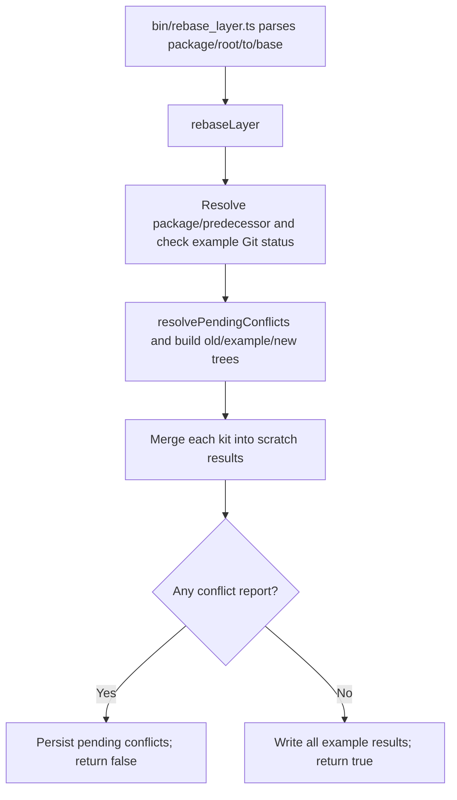

# US-OPS-06 — Rebase a package example layer

As a package-example maintainer, I want to rebase its examples onto a new predecessor so that every supported kit advances from a known lineage together.

**Status:** Operator; source-reviewed availability, not runtime-tested.
**Access:** Sandbox maintainer with the selected kit sources, supported Node 24/pnpm toolchain and filesystem access.
**Entry:** `pnpm rebase-layer --package <name> --root <checkout> (--to <version> | --base <commit>)`.
**Documentation:** [Repository instructions](../../docs/specification.md).
**Source:** [Rebase CLI](../../bin/rebase_layer.ts).

## Acceptance criteria

| Option      | Type                | Required/default/conditions                                               |
| ----------- | ------------------- | ------------------------------------------------------------------------- |
| `--package` | Package name        | Required; configured short name or full scoped name                       |
| `--root`    | Checkout path       | Required; selected example directories must have no uncommitted changes   |
| `--to`      | Predecessor version | Exactly one of to/base; used when package builds on another package       |
| `--base`    | Starter commit      | Exactly one of to/base; used when package builds directly on starter base |

- `rebaseLayer` builds each configured example merge using old predecessor, local example and new predecessor. It consumes edited pending conflict results from prior runs.
- If any kit conflicts, it reports files under `tmp/rebase-layer/<short>/conflicts/` and leaves example folders unchanged. Correct those files and rerun the same request.
- Only after every kit merges are example folders replaced. The command does not update sandbox versions, package peers or lockfile; predecessor lockfile changes produce follow-up guidance.
- Host filesystem failures during replacement propagate; the operation does not promise rollback of arbitrary write failures. Review resulting changes before committing the package checkout.

## User flow

## Code flow

Scope: Sandbox CLI through its implementation; generated application behavior is outside this operation.

**Code references:** [Rebase CLI](../../bin/rebase_layer.ts), [rebaseLayer](../../src/rebase_layer.ts), [Resolution records](../../src/resolutions.ts), [Rebase tests](../../tests/tooling/rebase_layer.spec.ts).
