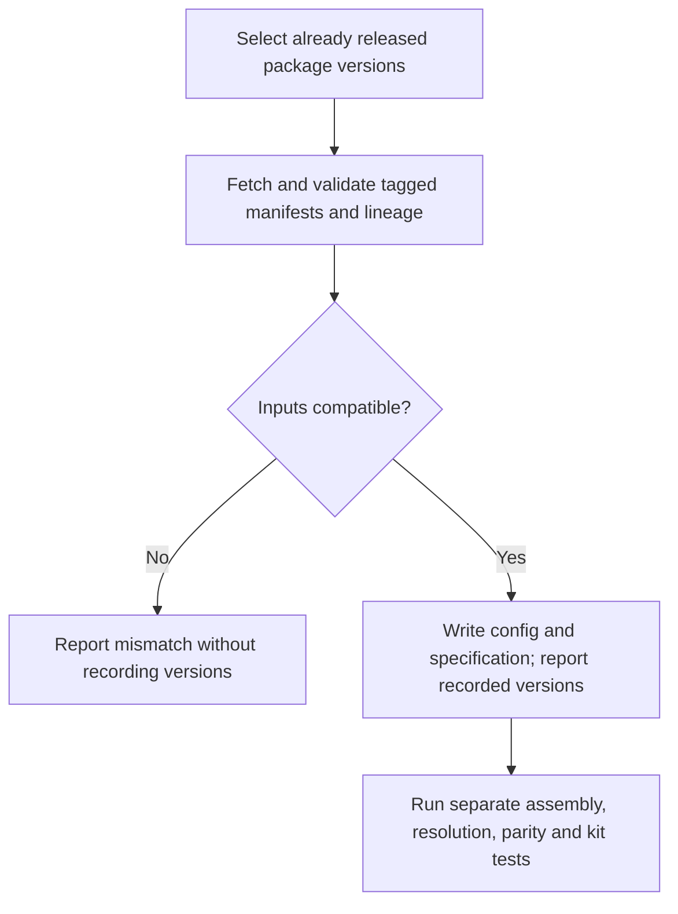
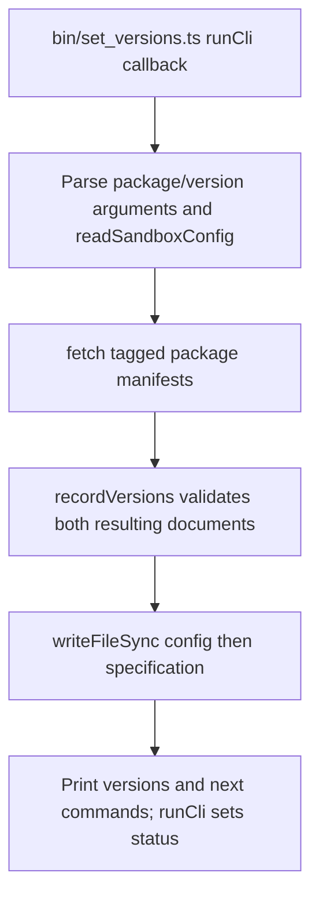

# US-OPS-07 — Record released package versions

As a sandbox maintainer, I want to record checked release-tag versions so that the sandbox tracks the exact predecessor lineage those releases declare.

**Status:** Operator; source-reviewed availability, not runtime-tested.
**Access:** Sandbox maintainer with the selected kit sources, supported Node 24/pnpm toolchain and filesystem access.
**Entry:** `pnpm set-versions <package>@<version>...`, for example `account-kit@0.3.5`.
**Documentation:** [Repository instructions](../../docs/specification.md).
**Source:** [Release-recording CLI](../../bin/set_versions.ts).

## Acceptance criteria

- Supply at least one configured short package name and an exact three-component numeric version; duplicate packages are refused. This command records already published releases; it does not publish or upgrade packages itself.
- For each package it fetches the `v<version>/package.json`, checks its declared version, and requires an exact predecessor peer when applicable. `recordVersions` rejects incompatible/stale lineage before writing.
- The config string is parsed and validated, including package versions and lineage. The specification string is calculated by replacing matching entries but is not separately validated; unmatched entries may remain unchanged. The files are written sequentially, so inspect both after an I/O failure.
- Success prints recorded versions and instructions to assemble, resolve unused conflicts, compare and test kits. Recording versions alone establishes none of those follow-up checks.

## User flow

## Code flow

Scope: Sandbox CLI through its implementation; generated application behavior is outside this operation.

**Code references:** [Release-recording CLI](../../bin/set_versions.ts), [recordVersions](../../src/package_versions.ts), [Sandbox config](../../config/sandbox.json), [Specification](../../docs/specification.md), [Version-record tests](../../tests/tooling/package_versions.spec.ts).
