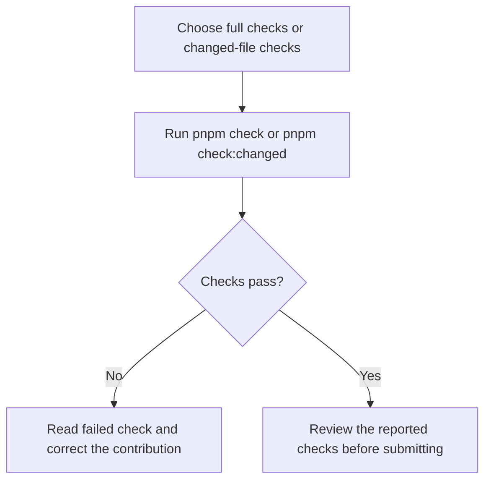
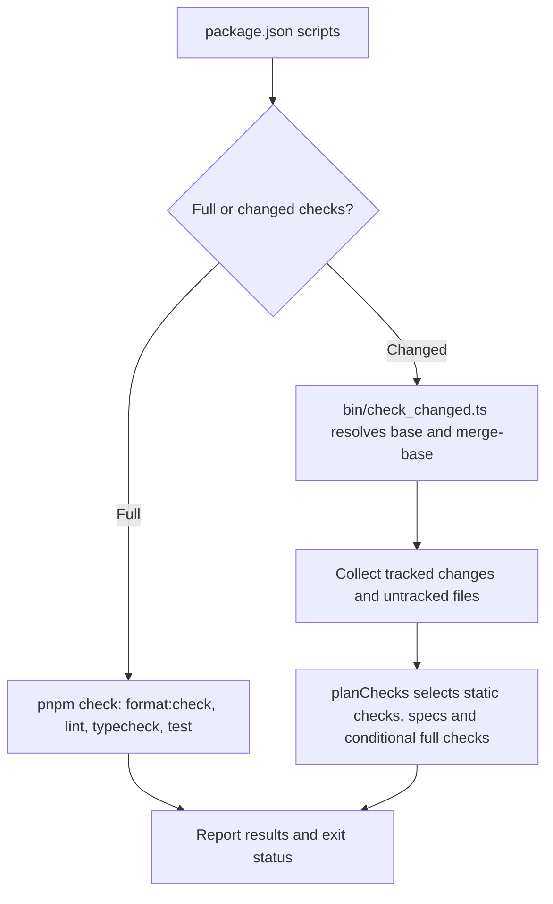

# US-OPS-08 — Validate a contribution

As a sandbox contributor, I want to run the checks suited to my changes so that I can catch formatting, lint, type, test and assembly issues before submitting them.

**Status:** Operator; source-reviewed availability, not runtime-tested.
**Access:** Sandbox contributor with the supported Node 24/pnpm toolchain, installed dependencies, and a Git base for changed-file checks.
**Entry:** Full checks: `pnpm check`. Change-aware checks: `pnpm check:changed [--static] [base]`.
**Documentation:** [Repository instructions](../../AGENTS.md).
**Source:** [Check scripts](../../package.json), [Changed-file check command](../../bin/check_changed.ts), [Changed-check plan](../../src/check_changed_plan.ts).

## Acceptance criteria

- `pnpm check` runs repository formatting, lint, typecheck and the Japa tooling suite.
- `pnpm check:changed` uses `origin/main` when available, otherwise `main`; an optional base ref selects another comparison point. It checks tracked changes from the merge base and untracked, non-ignored files.
- Change-aware checks format and lint changed files, run the applicable typecheck and changed specs, and run the full suite or assembly comparison when the changed inputs require them. `--static` omits the full suite and assembly comparison but still runs changed specs.
- The command reports each check as pass, fail or skip and exits nonzero for a failure. Passing checks validate the selected source checks, not assembled app runtime journeys.

## User flow

## Code flow

Scope: repository validation commands and the changed-check planner; this story does not claim a run was performed.

**Code references:** [Check scripts](../../package.json), [Changed-file check command](../../bin/check_changed.ts), [Changed-check planner](../../src/check_changed_plan.ts), [Repository instructions](../../AGENTS.md).
