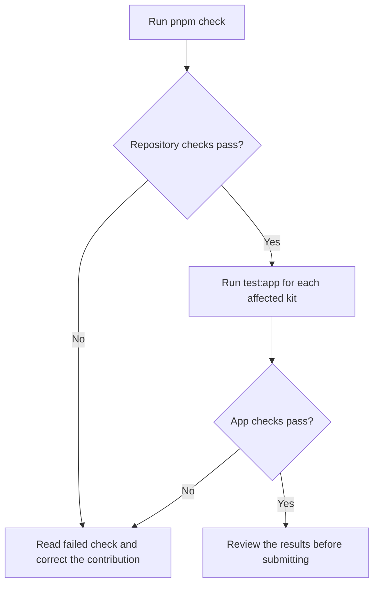
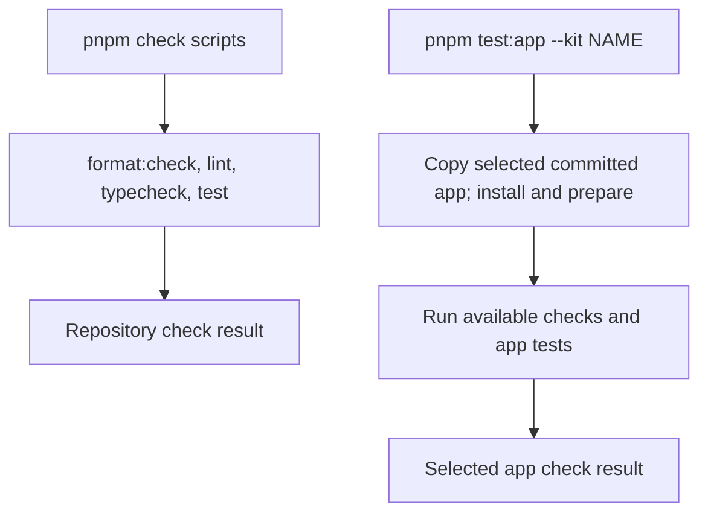

# US-OPS-08 — Validate a contribution

As a repository contributor, I want to run repository checks and direct app checks for affected kits so that I can catch documentation, tooling and app issues before submitting changes.

**Status:** Operator; source-reviewed availability, not runtime-tested.
**Access:** Repository contributor with the supported Node 24/pnpm toolchain and installed dependencies.
**Entry:** `pnpm check`, followed by `pnpm test:app --kit NAME [--install-browsers]` for each affected kit.
**Documentation:** [Run an app](../../README.md#run-an-app), [repository check scripts](../../package.json).
**Source:** [Check scripts](../../package.json), [App test command](../../bin/test_app.ts), [App test runner](../../src/app_test.ts).

## Acceptance criteria

- `pnpm check` runs repository formatting, lint, typecheck and the Japa tooling suite.
- Run `pnpm test:app --kit NAME [--install-browsers]` for each affected app; it installs and checks that committed app in a disposable copy, then runs its tests.
- `--install-browsers` installs Chromium when needed; without it, browser tests still run and require an existing browser installation.
- A failing command exits unsuccessfully. Repository checks do not replace app runtime checks, and app checks do not replace repository checks.

## User flow

## Code flow

Scope: repository validation commands and the changed-check planner; this story does not claim a run was performed.

**Code references:** [Check scripts](../../package.json), [Changed-file check command](../../bin/check_changed.ts), [Changed-check planner](../../src/check_changed_plan.ts), [Repository instructions](../../AGENTS.md).
