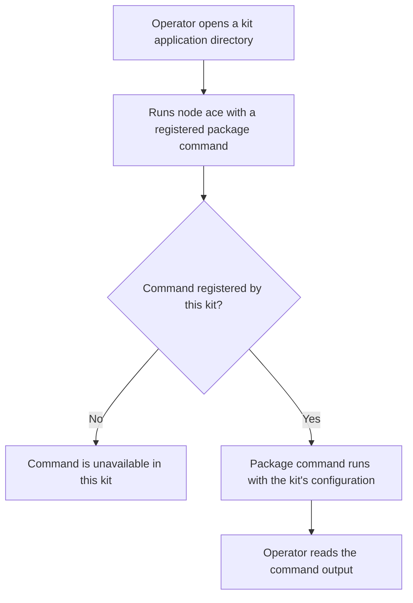
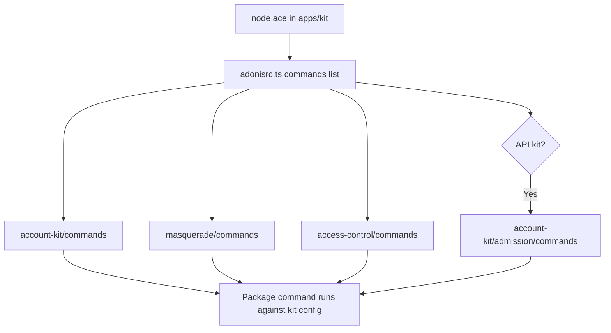

# US-OPS-09 — Run package operator commands in a kit

As a kit operator, I want to run the Ace commands that the installed Account Kit, Masquerade and Access Control packages register so that I can perform their operator tasks from the kit's own application directory.

**Status:** Operator; source-reviewed registration only. Command names, options and effects come from the pinned packages, whose source is not installed in this checkout, so they are not recorded here and are not runtime-tested.
**Access:** Kit operator with the kit's dependencies installed, a configured `.env` and, for commands that read or write application data, a migrated database.
**Entry:** From `apps/<kit>`: `node ace <command>`, for a command registered by that kit's `commands` list in `adonisrc.ts`.
**Documentation:** [Hypermedia app README](../../apps/hypermedia/README.md).
**Source:** [Hypermedia Ace registration](../../apps/hypermedia/adonisrc.ts), [API Ace registration](../../apps/api/adonisrc.ts), [React Ace registration](../../apps/inertia-react/adonisrc.ts), [Vue Ace registration](../../apps/inertia-vue/adonisrc.ts), [package pins](../../config/sandbox.json).

## Acceptance criteria

- Every kit registers three package command modules: Account Kit (`@kevinjohn/adonisjs-account-kit/commands`), Masquerade (`@kevinjohn/adonisjs-masquerade/commands`) and Access Control (`@kevinjohn/adonisjs-access-control/commands`).
- The API kit additionally registers the Account Kit admission module; see [US-OPS-10](us-ops-10-run-admission-commands.md).
- A command that is not registered by the kit is not available in that kit. Application commands in a kit's `./commands` directory are scanned separately.
- The sandbox does not wrap these commands; operator arguments and prompts are defined by each package and must be read from the package or its `--help` output for the pinned version.

## User flow

## Code flow

Scope: registration of package command modules in each kit; command implementations live in the pinned packages and are outside this story.

**Code references:** [Hypermedia adonisrc](../../apps/hypermedia/adonisrc.ts), [API adonisrc](../../apps/api/adonisrc.ts), [React adonisrc](../../apps/inertia-react/adonisrc.ts), [Vue adonisrc](../../apps/inertia-vue/adonisrc.ts), [App Ace entry](../../apps/hypermedia/ace.js), [package pins](../../config/sandbox.json).
