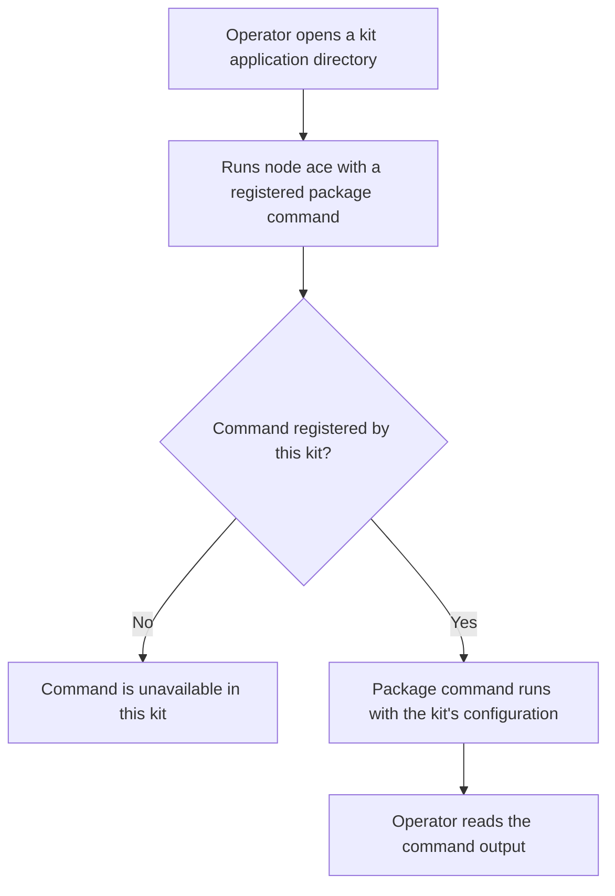
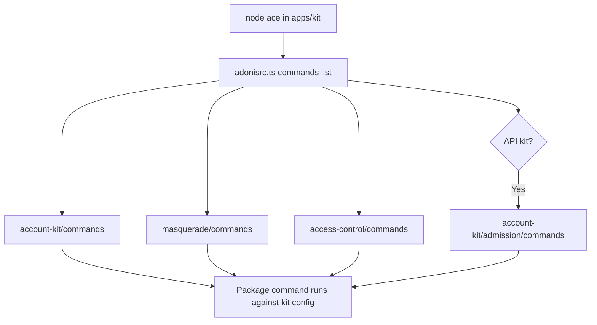

# US-OPS-09 — Run package operator commands in a kit

As a kit operator, I want to run the Ace commands that the installed Account Kit, Masquerade and Access Control packages register so that I can perform their operator tasks from the kit's own application directory.

**Status:** Operator; commands read from the tagged package source (`@kevinjohn/adonisjs-account-kit` 0.3.4, `@kevinjohn/adonisjs-masquerade` 0.2.8, `@kevinjohn/adonisjs-access-control` 0.1.7), not runtime-tested here. Flag spellings are the kebab-case form Ace derives from each declared flag.
**Access:** Kit operator with the kit's dependencies installed, a configured `.env` and, for commands that read or write application data, a migrated database.
**Entry:** From `apps/<kit>`: `node ace <command>`, for a command registered by that kit's `commands` list in `adonisrc.ts`.
**Documentation:** [Hypermedia app README](../../apps/hypermedia/README.md).
**Source:** [Hypermedia Ace registration](../../apps/hypermedia/adonisrc.ts), [API Ace registration](../../apps/api/adonisrc.ts), [React Ace registration](../../apps/inertia-react/adonisrc.ts), [Vue Ace registration](../../apps/inertia-vue/adonisrc.ts), [package pins](../../config/sandbox.json); `@kevinjohn/adonisjs-account-kit` 0.3.4 `commands/main.ts`; `@kevinjohn/adonisjs-masquerade` 0.2.8 `commands/main.ts`, `src/active_modes.ts`, `src/prune.ts`; `@kevinjohn/adonisjs-access-control` 0.1.7 `commands/main.ts`.

## Acceptance criteria

- Every kit registers three package command modules: Account Kit (`@kevinjohn/adonisjs-account-kit/commands`), Masquerade (`@kevinjohn/adonisjs-masquerade/commands`) and Access Control (`@kevinjohn/adonisjs-access-control/commands`).
- The API kit additionally registers the Account Kit admission module; see [US-OPS-10](us-ops-10-run-admission-commands.md).
- A command that is not registered by the kit is not available in that kit. Application commands in a kit's `./commands` directory are scanned separately.
- The sandbox does not wrap these commands. Each package's `commands/main.ts` lists exactly the commands below; a command file that `main.ts` does not list is not registered.

### Account Kit commands (0.3.4, `commands/main.ts`)

| Command                         | Arguments and flags                                                                                                                                                                                                    | Purpose (package description)                                                                                     |
| ------------------------------- | ---------------------------------------------------------------------------------------------------------------------------------------------------------------------------------------------------------------------- | ----------------------------------------------------------------------------------------------------------------- |
| `account-kit:prune`             | `--batch-size` (number, 1–1000), `--max-batches` (number, 1–1000), `--dry-run` (boolean: count expired rows without deleting)                                                                                          | Remove expired password-reset, invitation, email-verification, magic-link, social authentication and session rows |
| `account-kit:setup`             | `--input` (path to typed noninteractive JSON choices), `--apply` (apply the complete conflict-free plan; preview is the default), `--check`, `--production`, `--retirement-maintenance-window`; does not start the app | Inspect, preview and apply Account Kit onboarding choices                                                         |
| `account-kit:retirement-impact` | `--quiet` (return the structured result without printing it), `--keep-password-login`, `--providers` (comma-separated provider names remaining after the change)                                                       | Count accounts affected by retiring login methods                                                                 |
| `account-kit:doctor`            | none                                                                                                                                                                                                                   | Check config, limiter, APP_URL and database tables for Account Kit                                                |
| `account-kit:invite`            | argument `email`; `--role` (required, 1–64 characters), `--scope` (1–255 characters), `--print` (print the acceptance link instead of emailing it)                                                                     | Invite an email address as an operator, replacing any pending invitation                                          |
| `account-kit:reset-link`        | argument `email`; `--print` (print the reset link instead of emailing it)                                                                                                                                              | Issue a password-reset link for an account, replacing its live reset link                                         |
| `account-kit:openapi`           | `--output` (write to this file instead of stdout), `--title`, `--api-version`                                                                                                                                          | Print an OpenAPI 3.1 document for the registered managed routes                                                   |
| `account-kit:admission:install` | `--users-table` (default `users`), `--user-id-type` (`integer`, `string` or `uuid`; default `integer`)                                                                                                                 | Add the admission module: migration, `config/admission.ts`, provider and commands                                 |

### Masquerade commands (0.2.8, `commands/main.ts`)

| Command             | Arguments and flags                                                                                                                                                                                       | Purpose (package description)                                                        |
| ------------------- | --------------------------------------------------------------------------------------------------------------------------------------------------------------------------------------------------------- | ------------------------------------------------------------------------------------ |
| `masquerade:prune`  | `--batch-size` (number, 1–1000, default 100)                                                                                                                                                              | Expire outdated masquerade modes and prune retained events                           |
| `masquerade:routes` | none                                                                                                                                                                                                      | Report masquerade route coverage and markers                                         |
| `masquerade:status` | `--limit` (number, 1–1000, default 50)                                                                                                                                                                    | List active masquerade modes (namespace, actor, incarnation, target, access, expiry) |
| `masquerade:stop`   | `--actor` (operator account ID), `--incarnation` (only with `--actor`), `--all` (end every active mode), `--force` (skip the `--all` confirmation); pass exactly one of `--actor` or `--all`, else exit 1 | End an operator's active masquerade mode, or every active mode                       |

### Access Control commands (0.1.7, `commands/main.ts`)

| Command                 | Arguments and flags                                                        | Purpose (package description)                                                                                                                   |
| ----------------------- | -------------------------------------------------------------------------- | ----------------------------------------------------------------------------------------------------------------------------------------------- |
| `access-control:doctor` | `--scope` (restrict the row checks to one scope id), `--json` (print JSON) | Check the memberships table against `config/access_control.ts`; exit code 0 when clean, 1 when a check finds rows, 2 when a check could not run |

## User flow

## Code flow

Scope: registration of package command modules in each kit; command implementations live in the pinned packages and are outside this story except for the names and flags recorded above.

**Code references:** [Hypermedia adonisrc](../../apps/hypermedia/adonisrc.ts), [API adonisrc](../../apps/api/adonisrc.ts), [React adonisrc](../../apps/inertia-react/adonisrc.ts), [Vue adonisrc](../../apps/inertia-vue/adonisrc.ts), [App Ace entry](../../apps/hypermedia/ace.js), [package pins](../../config/sandbox.json).
