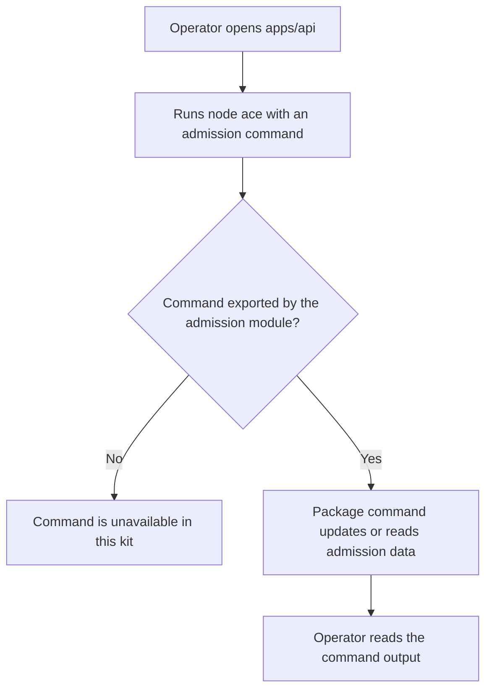
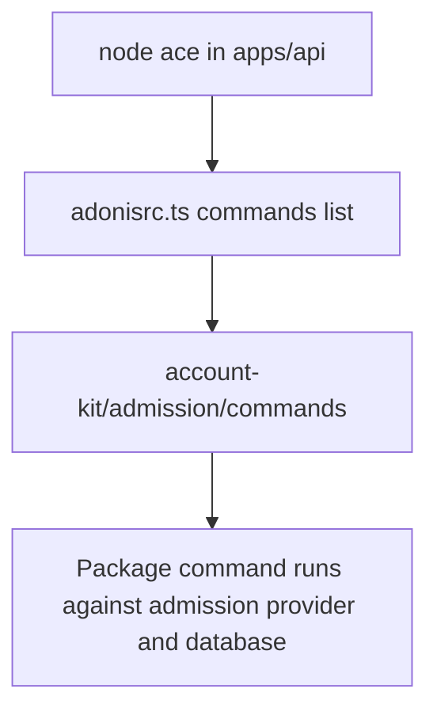

# US-OPS-10 — Run API admission operator commands

As an API kit operator, I want to run the Account Kit admission commands so that I can manage admission from the command line as well as through the admission routes.

**Status:** Operator; source-reviewed registration only. Command names, options and effects come from the pinned Account Kit package, whose source is not installed in this checkout, so they are not recorded here and are not runtime-tested.
**Access:** API kit operator with installed dependencies, a configured `.env` and a migrated database.
**Entry:** From `apps/api`: `node ace <command>`, for a command exported by `@kevinjohn/adonisjs-account-kit/admission/commands`.
**Documentation:** [API kit README](../../apps/api/README.md).
**Source:** [API Ace registration](../../apps/api/adonisrc.ts), [admission provider registration](../../apps/api/adonisrc.ts), [package pin](../../config/sandbox.json).

## Acceptance criteria

- Only the API kit registers the admission command module; the browser kits do not.
- These commands are the operator-side counterpart to the admission routes in [US-API-14](../api/us-api-14-read-admission.md) to [US-API-19](../api/us-api-19-revoke-admission.md); route access rules in those stories do not describe command access.
- The commands act on the same configured admission data as the API routes; their inputs and outcomes are defined by the pinned package.

## User flow

## Code flow

Scope: registration of the admission command module; command implementations live in the pinned package and are outside this story.

**Code references:** [API adonisrc](../../apps/api/adonisrc.ts), [package pin](../../config/sandbox.json), [admission functional tests](../../apps/api/tests/functional/admission.spec.ts).
