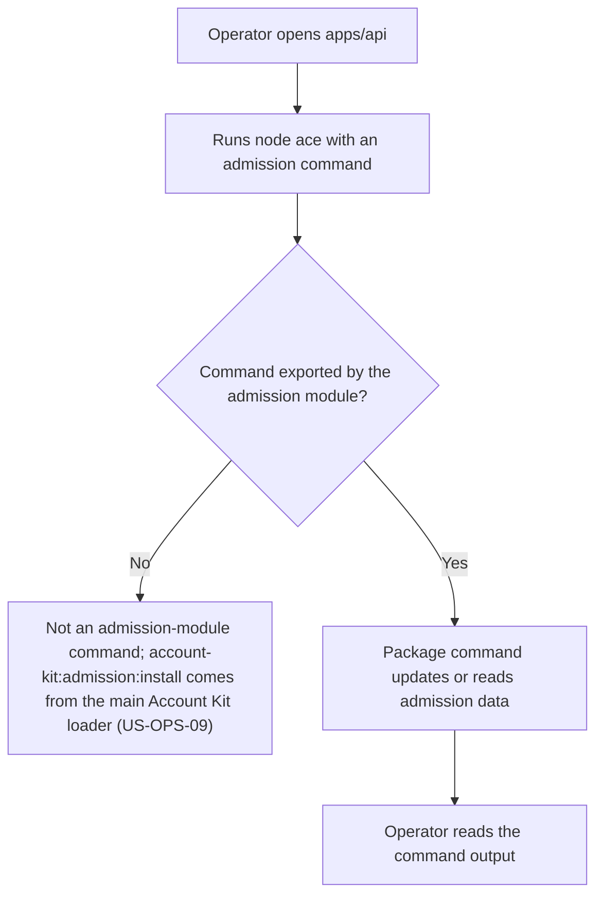
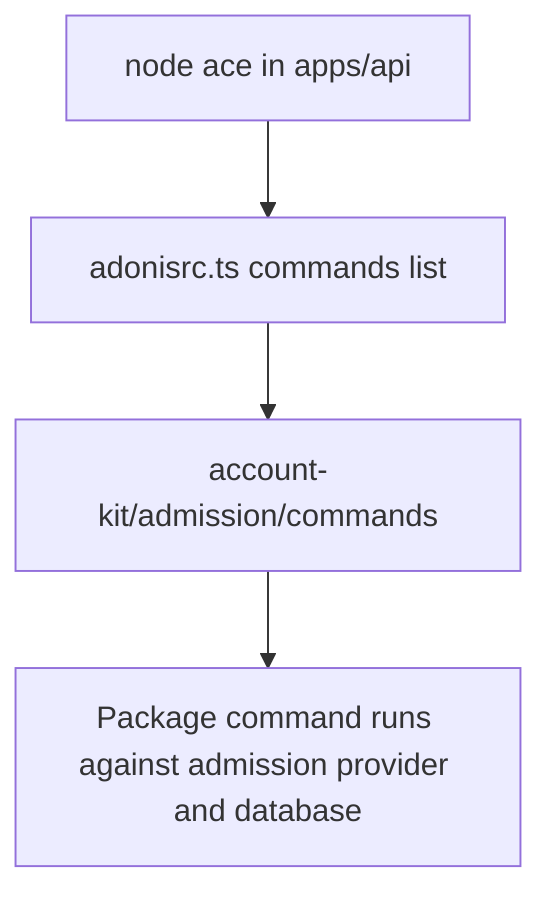

# US-OPS-10 — Run API admission operator commands

As an API kit operator, I want to run the Account Kit admission commands so that I can manage admission from the command line as well as through the admission routes.

**Status:** Operator; commands read from the tagged package source (`@kevinjohn/adonisjs-account-kit` 0.6.1 `src/admission/commands/main.ts`), not runtime-tested here.
**Access:** API kit operator with installed dependencies, a configured `.env` and a migrated database.
**Entry:** From `apps/api`: `node ace <command>`, for a command exported by `@kevinjohn/adonisjs-account-kit/admission/commands`.
**Documentation:** [Run an app](../../README.md#run-an-app).
**Source:** [API Ace registration](../../apps/api/adonisrc.ts); command behavior is supplied by the installed Account Kit admission module.

## Acceptance criteria

- Only the API kit registers the admission command module; the browser kits do not.
- The module is registered beside the admission routes covered by [US-API-17](../api/us-api-17-approve-admission.md) and [US-API-19](../api/us-api-19-revoke-admission.md); route access rules in those stories do not describe command access. The package source does not state a route-to-command mapping, so none is recorded.
- The module registers exactly four commands (`@kevinjohn/adonisjs-account-kit` 0.6.1 `src/admission/commands/main.ts`); each takes the account email as its argument and acts on the configured admission data through the package's operator API, without actor authorization.

| Command                                  | Arguments and flags                                                                                                                                                                              | Purpose (package description)                                                                                   |
| ---------------------------------------- | ------------------------------------------------------------------------------------------------------------------------------------------------------------------------------------------------ | --------------------------------------------------------------------------------------------------------------- |
| `account-kit:admission:approve`          | argument `email`                                                                                                                                                                                 | Approve an account as an operator, for the first administrator or recovery                                      |
| `account-kit:admission:revoke`           | argument `email`                                                                                                                                                                                 | Revoke an approved account as an operator; the account keeps signing in but no longer passes the admission gate |
| `account-kit:admission:grant-invitation` | argument `email`; `--role` (stored on the record only; it grants nothing)                                                                                                                        | Record invitation evidence for an existing account as an operator                                               |
| `account-kit:admission:bootstrap`        | argument `email`; `--role` (1–64 characters; required unless `--cancel` is passed, else the command fails with `Invalid role`), `--cancel` (delete the waiting approval for the address instead) | Invite an address as an operator and approve the account it creates, printing the link                          |

- `account-kit:admission:install` is not part of this module; it is registered by the main Account Kit loader and is listed in [US-OPS-09](us-ops-09-run-package-commands.md).
- Bootstrap creates the replacement invitation and matching approval together. If replacement fails, the previous invitation and approval remain in place.

## User flow

## Code flow

Scope: registration of the admission command module; command implementations live in the pinned package and are outside this story except for the names and flags recorded above.

**Code references:** [API adonisrc](../../apps/api/adonisrc.ts), [admission functional tests](../../apps/api/tests/functional/admission.spec.ts).
