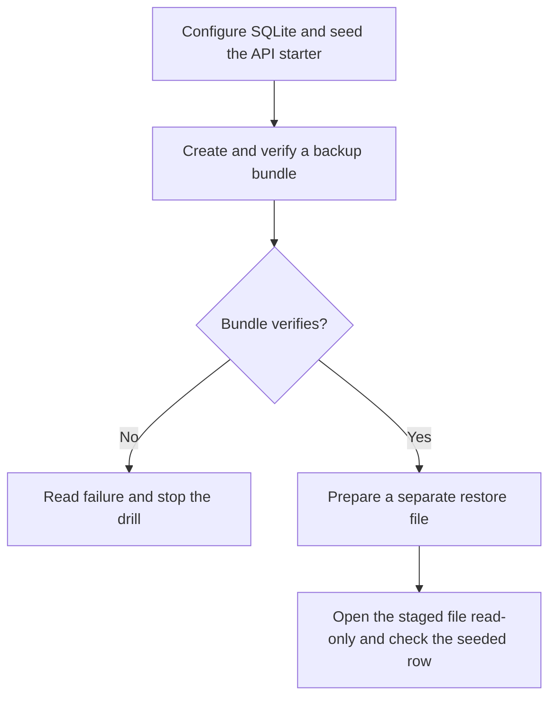
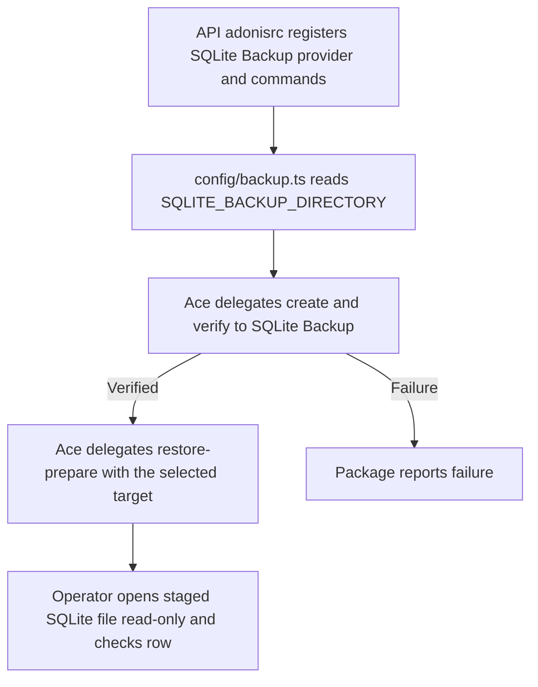

# US-OPS-11 — Recover a row from an API starter backup

As an API app operator, I want to verify a backup and recover a seeded row into a separate SQLite file so that I can check that a usable copy exists.

**Status:** Operator
**Access:** Local API starter operator with a migrated SQLite database, a writable backup directory and a distinct restore target.
**Entry:** Follow the SQLite backup drill from `apps/api`.
**Documentation:** [Backup recovery drill](../../docs/cookbook/sqlite-backup.md).
**Source:** [backup.ts](../../apps/api/config/backup.ts), [adonisrc.ts](../../apps/api/adonisrc.ts)
**Coverage:** [sqlite_backup.spec.ts](../../apps/api/tests/functional/sqlite_backup.spec.ts)

## Acceptance criteria

- Set `DB_CONNECTION=sqlite` and `SQLITE_BACKUP_DIRECTORY` to the directory for the drill. The starter leaves backups disabled when the directory is unset.
- Seed the demo accounts, then run `node ace db:backup create`, `node ace db:backup verify`, and `node ace db:backup restore-prepare --target <file>`. Use a new destination outside the backup directory. The package reports verification or preparation failures.
- Open the staged file read-only and check for the seeded account from the recipe. The app continues to use its original database.

## User flow

## Code flow

**Code references:** [adonisrc.ts](../../apps/api/adonisrc.ts), [backup.ts](../../apps/api/config/backup.ts), [sqlite_backup.spec.ts](../../apps/api/tests/functional/sqlite_backup.spec.ts).
