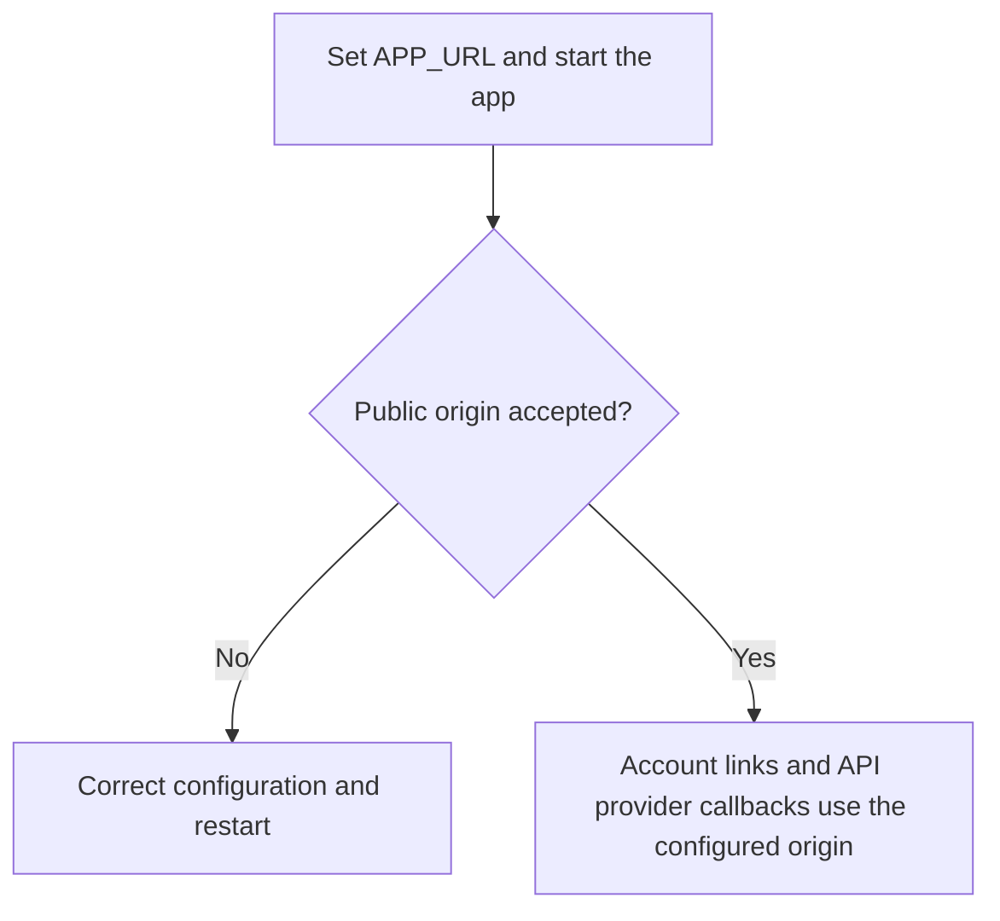
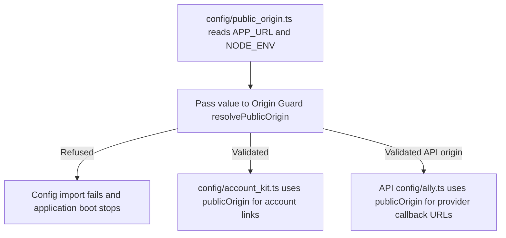

# US-OPS-12 — Configure the public origin for account links

As an app operator, I want to set the public origin so that account proof links and API provider callbacks use the intended address.

**Status:** Operator
**Access:** Operator configuring an app environment before boot.
**Entry:** Set `APP_URL` before starting any of the four apps.
**Documentation:** [Public origin recipe](../../docs/cookbook/public-origin.md).
**Source:** [api](../../apps/api/config/public_origin.ts), [hypermedia](../../apps/hypermedia/config/public_origin.ts), [inertia-react](../../apps/inertia-react/config/public_origin.ts), [inertia-vue](../../apps/inertia-vue/config/public_origin.ts)
**Coverage:** [api](../../apps/api/tests/functional/public_origin.spec.ts), [hypermedia](../../apps/hypermedia/tests/functional/public_origin.spec.ts), [inertia-react](../../apps/inertia-react/tests/functional/public_origin.spec.ts), [inertia-vue](../../apps/inertia-vue/tests/functional/public_origin.spec.ts)

## Acceptance criteria

- Set `APP_URL` to the bare origin people use, without a path or trailing slash. The example can use an HTTP localhost origin in development. Production boot refuses a public HTTP origin.
- All four apps use the validated origin for Account Kit links. The API also uses it for configured provider callbacks. On startup refusal, correct the environment and restart.

## User flow

## Code flow

**Code references:** [api](../../apps/api/config/public_origin.ts), [hypermedia](../../apps/hypermedia/config/public_origin.ts), [inertia-react](../../apps/inertia-react/config/public_origin.ts), [inertia-vue](../../apps/inertia-vue/config/public_origin.ts), [ally.ts](../../apps/api/config/ally.ts), [account_kit.ts](../../apps/api/config/account_kit.ts).
