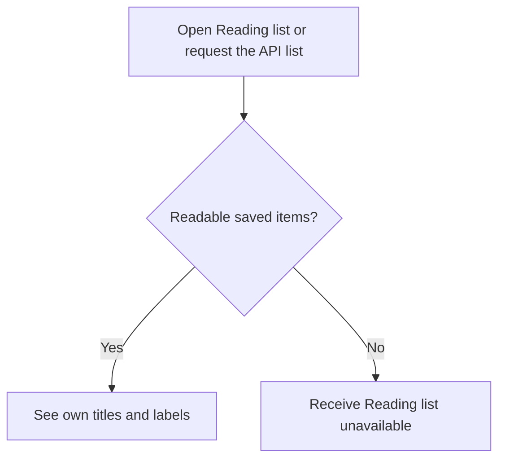
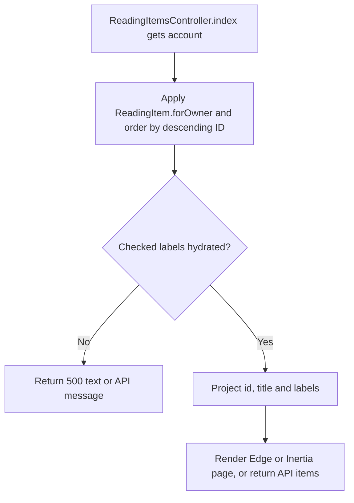

# US-READ-01 — View my reading list

As a signed-in account holder, I want to view my reading list so that I can see saved titles and labels.

**Status:** Current
**Access:** Raw signed-in browser account. The Account Kit blocker applies during support mode. The API additionally applies account access checks to its selected guard.
**Entry:** Browser **Reading list** at `GET /reading-items`; API `GET /api/v1/account/reading-items`.
**Documentation:** [Checked Columns recipe](../../docs/cookbook/checked-columns.md).
**Source:** [api](../../apps/api/app/controllers/reading_items_controller.ts), [hypermedia](../../apps/hypermedia/app/controllers/reading_items_controller.ts), [inertia-react](../../apps/inertia-react/app/controllers/reading_items_controller.ts), [inertia-vue](../../apps/inertia-vue/app/controllers/reading_items_controller.ts)
**Coverage:** [api](../../apps/api/tests/functional/reading_items.spec.ts), [hypermedia](../../apps/hypermedia/tests/functional/reading_items.spec.ts), [inertia-react](../../apps/inertia-react/tests/functional/reading_items.spec.ts), [inertia-vue](../../apps/inertia-vue/tests/functional/reading_items.spec.ts)

## Acceptance criteria

- The list contains only this account's items, ordered by descending ID. Browser pages show each title and its labels; API returns `{ items: [{ id, title, labels }] }`.
- If a stored labels value cannot be hydrated, the controller returns HTTP 500 **Reading list unavailable**. Browser kits return text and the API returns a JSON message.

## User flow

## Code flow

**Code references:** [api](../../apps/api/start/reading_items_routes.ts), [hypermedia](../../apps/hypermedia/start/reading_items_routes.ts), [inertia-react](../../apps/inertia-react/start/reading_items_routes.ts), [inertia-vue](../../apps/inertia-vue/start/reading_items_routes.ts); [api](../../apps/api/app/controllers/reading_items_controller.ts), [hypermedia](../../apps/hypermedia/app/controllers/reading_items_controller.ts), [inertia-react](../../apps/inertia-react/app/controllers/reading_items_controller.ts), [inertia-vue](../../apps/inertia-vue/app/controllers/reading_items_controller.ts). [Package handoffs](../REFERENCE.md#package-handoffs).
