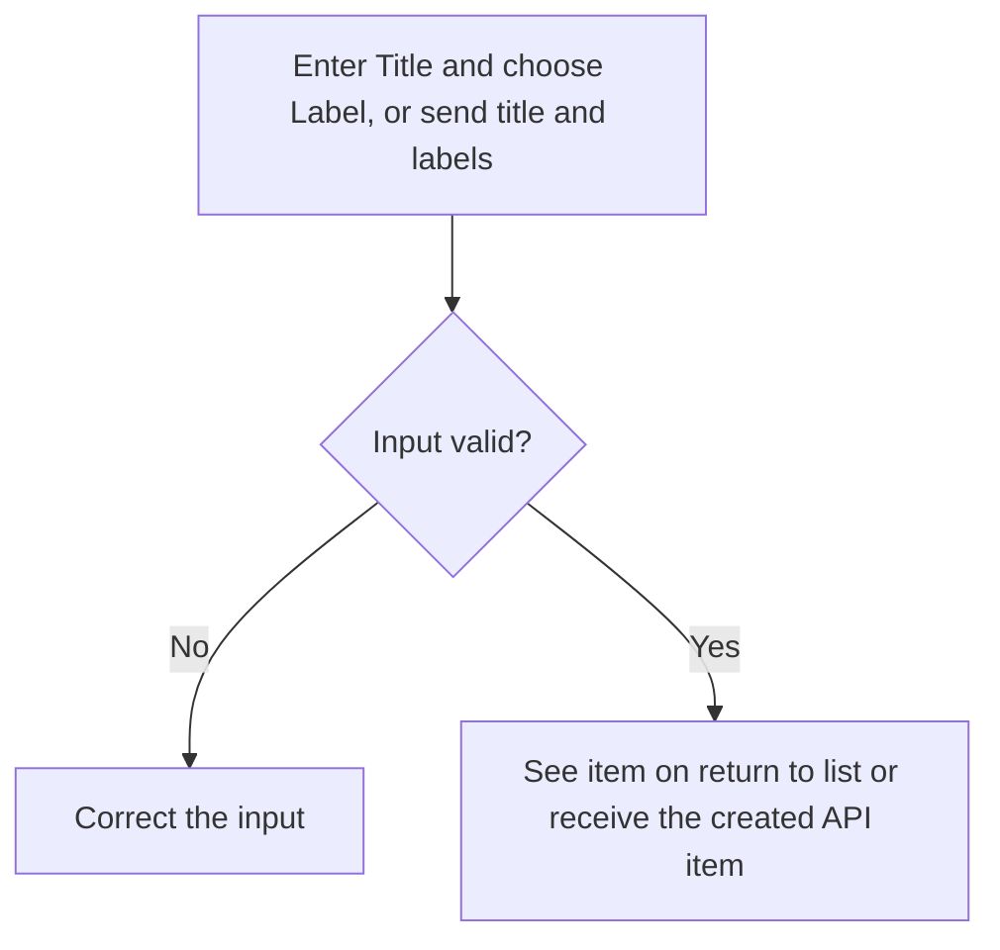
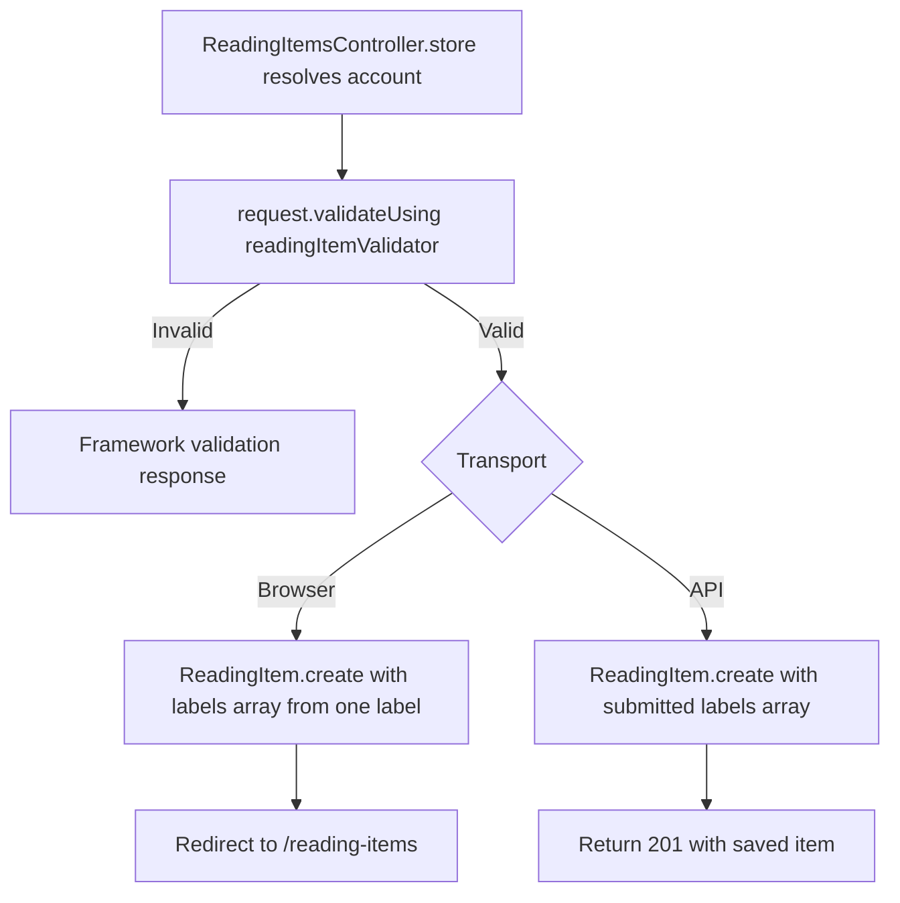

# US-READ-02 — Add an item to my reading list

As a signed-in account holder, I want to add a titled and labelled reading item so that I can find it in my own reading list.

**Status:** Current
**Access:** Raw signed-in browser account. The Account Kit blocker applies during support mode. The API additionally applies account access checks to its selected guard.
**Entry:** Browser **Add item** at `/reading-items`; API `POST /api/v1/account/reading-items`.
**Documentation:** [Checked Columns recipe](../../docs/cookbook/checked-columns.md).
**Source:** [api](../../apps/api/app/controllers/reading_items_controller.ts), [hypermedia](../../apps/hypermedia/app/controllers/reading_items_controller.ts), [inertia-react](../../apps/inertia-react/app/controllers/reading_items_controller.ts), [inertia-vue](../../apps/inertia-vue/app/controllers/reading_items_controller.ts)
**Coverage:** [api](../../apps/api/tests/functional/reading_items.spec.ts), [hypermedia](../../apps/hypermedia/tests/functional/reading_items.spec.ts), [inertia-react](../../apps/inertia-react/tests/functional/reading_items.spec.ts), [inertia-vue](../../apps/inertia-vue/tests/functional/reading_items.spec.ts)

## Acceptance criteria

- **Title** is an initially empty required field, trimmed on the server, with a limit of 200 characters. Browser **Label** is a selector with **Work** selected by default and **Personal** and **Reference** as alternatives.
- API accepts required `title` and `labels`. `labels` is an array whose entries are `work`, `personal` or `reference`. Browser form submits a single `label` and the controller wraps it in an array.
- Browser redirects to the reading list with the new item. API returns HTTP 201 with its `id`, `title` and `labels`. Invalid input goes through the framework validation response before any item is written.

## User flow

## Code flow

**Code references:** [api](../../apps/api/start/reading_items_routes.ts), [hypermedia](../../apps/hypermedia/start/reading_items_routes.ts), [inertia-react](../../apps/inertia-react/start/reading_items_routes.ts), [inertia-vue](../../apps/inertia-vue/start/reading_items_routes.ts); [api](../../apps/api/app/controllers/reading_items_controller.ts), [hypermedia](../../apps/hypermedia/app/controllers/reading_items_controller.ts), [inertia-react](../../apps/inertia-react/app/controllers/reading_items_controller.ts), [inertia-vue](../../apps/inertia-vue/app/controllers/reading_items_controller.ts); [api](../../apps/api/app/validators/reading_item.ts), [hypermedia](../../apps/hypermedia/app/validators/reading_item.ts), [inertia-react](../../apps/inertia-react/app/validators/reading_item.ts), [inertia-vue](../../apps/inertia-vue/app/validators/reading_item.ts). [Package handoffs](../REFERENCE.md#package-handoffs).
