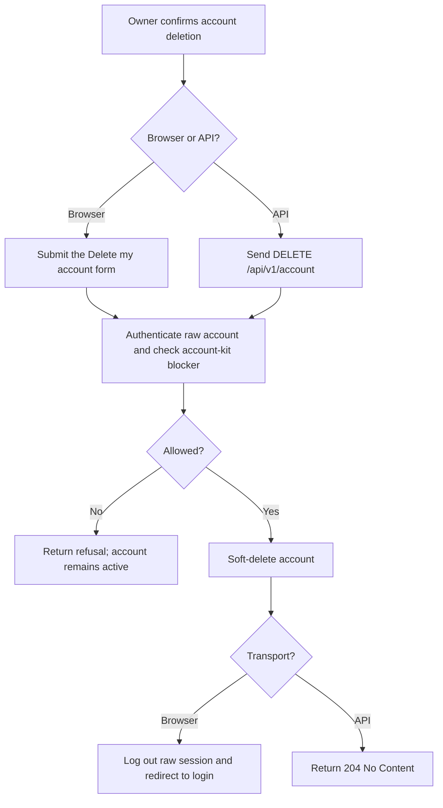
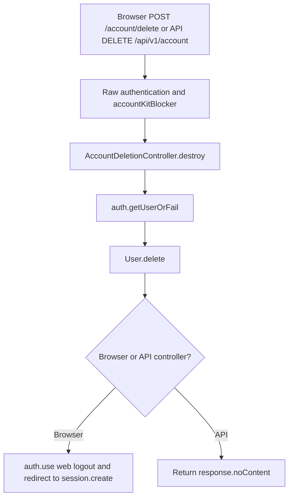

# US-DELETE-01 — Delete the signed-in account

As a signed-in account owner, I want to soft-delete my account so that it no longer appears as active or signs in through normal account lookup.

**Status:** Current; source-reviewed, not runtime-tested here.
**Access:** Authenticated raw account; Account Kit blocker prevents this native-account action during support mode.
**Entry:** Browser kits: `GET/POST /account/delete`; API: `DELETE /api/v1/account`.
**Documentation:** [Soft-delete account guide](../../docs/cookbook/soft-delete-with-account-kit.md#protect-self-deletion-routes).
**Source:** [Hypermedia deletion routes](../../apps/hypermedia/start/routes.ts), [API deletion route](../../apps/api/start/routes.ts).
**Coverage:** [API HTTP routes](../../apps/api/tests/functional/soft_delete.spec.ts), [Hypermedia routes](../../apps/hypermedia/tests/functional/soft_delete.spec.ts), [React routes](../../apps/inertia-react/tests/functional/soft_delete.spec.ts), [Vue routes](../../apps/inertia-vue/tests/functional/soft_delete.spec.ts), and [Hypermedia browser journey](../../apps/hypermedia/tests/browser/soft_delete.spec.ts), [React browser journey](../../apps/inertia-react/tests/browser/soft_delete.spec.ts), [Vue browser journey](../../apps/inertia-vue/tests/browser/soft_delete.spec.ts); these links identify source behavior coverage, not runtime verification of these docs.

## Acceptance criteria

- The browser confirmation page has a button labeled “Delete my account”; there is no typed confirmation field. API has no body fields.
- The handler calls `User.delete()`, storing deletion state while retaining the row. Normal user lookup excludes the soft-deleted account, so the account cannot sign in until an administrator restores it.
- Browser then logs out raw `web` and redirects to login. API returns `204 No Content`; it does not claim that a separate token revocation was performed.
- The account-kit blocker refuses deletion during support mode. Database failure is surfaced rather than reported as successful deletion.

## User flow

## Code flow

**Code references:** [Hypermedia routes and blocker](../../apps/hypermedia/start/routes.ts), [Hypermedia confirmation view](../../apps/hypermedia/resources/views/pages/account/delete.edge), [Hypermedia controller](../../apps/hypermedia/app/controllers/account_deletion_controller.ts), [API routes and guard](../../apps/api/start/routes.ts), [API controller](../../apps/api/app/controllers/account_deletion_controller.ts), [User soft-delete model](../../apps/api/app/models/user.ts), [API HTTP routes](../../apps/api/tests/functional/soft_delete.spec.ts), [Inertia React controller](../../apps/inertia-react/app/controllers/account_deletion_controller.ts), [Inertia Vue controller](../../apps/inertia-vue/app/controllers/account_deletion_controller.ts).
