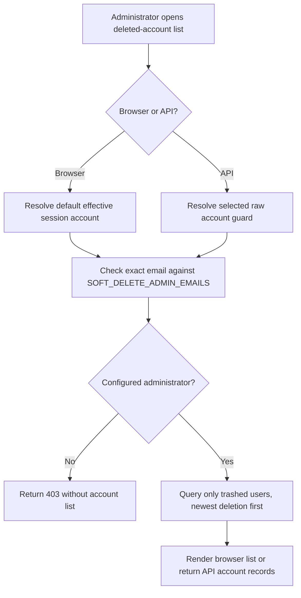
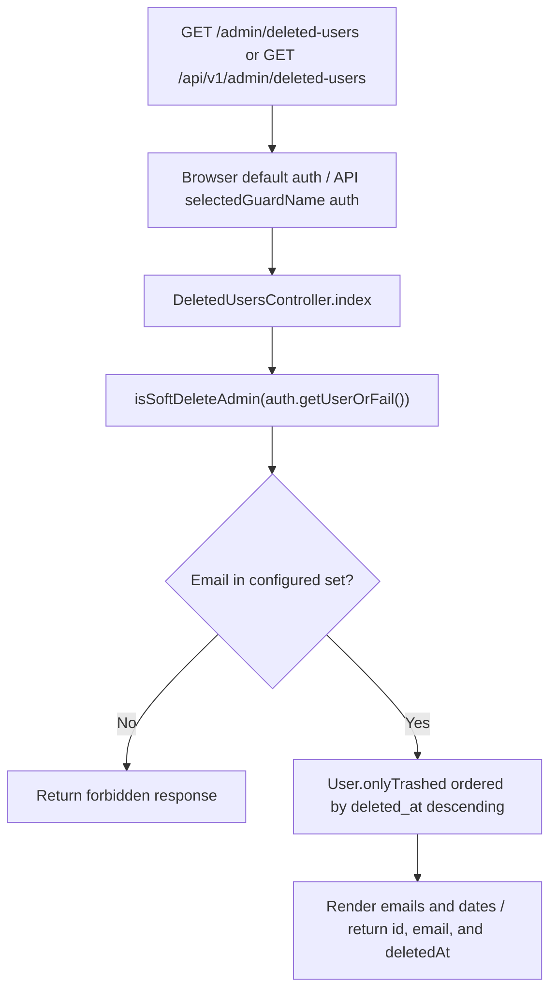

# US-DELETE-02 — Review deleted accounts

As a configured soft-delete administrator, I want to review deleted accounts so that I can find an account eligible for restoration.

**Status:** Current; source-reviewed, not runtime-tested here.
**Access:** Email must exactly match an entry in `SOFT_DELETE_ADMIN_EMAILS`. Browser routes use the default effective session guard; API routes use the configured raw account guard.
**Entry:** Browser kits: `GET /admin/deleted-users`; API: `GET /api/v1/admin/deleted-users`.
**Documentation:** [Soft-delete administration guide](../../docs/cookbook/soft-delete-with-account-kit.md#expose-deleted-account-administration).
**Source:** [Hypermedia admin routes](../../apps/hypermedia/start/routes.ts), [API admin routes](../../apps/api/start/routes.ts).
**Coverage:** [API HTTP routes](../../apps/api/tests/functional/soft_delete.spec.ts), [Hypermedia routes](../../apps/hypermedia/tests/functional/soft_delete.spec.ts), [React routes](../../apps/inertia-react/tests/functional/soft_delete.spec.ts), [Vue routes](../../apps/inertia-vue/tests/functional/soft_delete.spec.ts), and [Hypermedia browser journey](../../apps/hypermedia/tests/browser/soft_delete.spec.ts), [React browser journey](../../apps/inertia-react/tests/browser/soft_delete.spec.ts), [Vue browser journey](../../apps/inertia-vue/tests/browser/soft_delete.spec.ts); these links identify source behavior coverage, not runtime verification of these docs.

## Acceptance criteria

- There are no editable fields; an administrator opens the deleted-users page or sends the API request.
- Only the selected account's exact email is checked against the trimmed configured address set. During browser support mode the effective target identity is checked; API uses the selected raw account guard.
- An unauthorized account receives `403` and no deleted-account list.
- Authorized results come from `User.onlyTrashed()` ordered by `deleted_at` descending. Browser shows email and deletion date with a restore action; API returns each account's ID, email, and deletion timestamp. Active users are not included.

## User flow

## Code flow

**Code references:** [Hypermedia routes](../../apps/hypermedia/start/routes.ts), [Hypermedia controller](../../apps/hypermedia/app/controllers/deleted_users_controller.ts), [Deleted-users view](../../apps/hypermedia/resources/views/pages/deleted_users.edge), [Admin email configuration](../../apps/hypermedia/app/services/soft_delete_admins.ts), [API routes](../../apps/api/start/routes.ts), [API controller](../../apps/api/app/controllers/deleted_users_controller.ts), [API admin email configuration](../../apps/api/app/services/soft_delete_admins.ts), [API HTTP routes](../../apps/api/tests/functional/soft_delete.spec.ts), [Inertia React controller](../../apps/inertia-react/app/controllers/deleted_users_controller.ts), [Inertia Vue controller](../../apps/inertia-vue/app/controllers/deleted_users_controller.ts).
