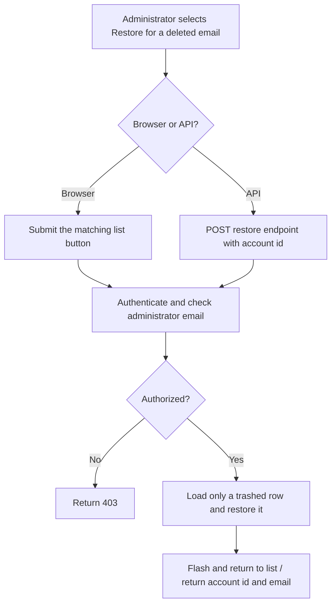
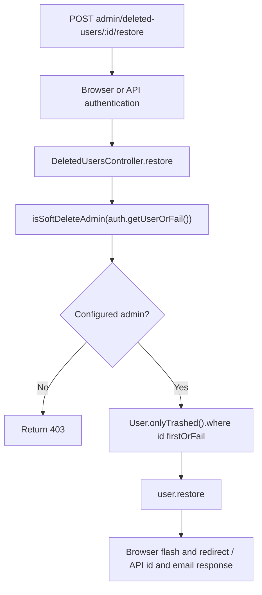

# US-DELETE-03 — Restore a deleted account

As a configured soft-delete administrator, I want to restore a selected deleted account so that it can be found by normal account lookup again.

**Status:** Current; source-reviewed, not runtime-tested here.
**Access:** Email must exactly match `SOFT_DELETE_ADMIN_EMAILS`; browser checks the default effective session account, API checks the selected raw account guard. Target must be soft-deleted.
**Entry:** Browser kits: submit the “Restore <email>” action; API: `POST /api/v1/admin/deleted-users/:id/restore`.
**Documentation:** [Soft-delete administration guide](../../docs/cookbook/soft-delete-with-account-kit.md#expose-deleted-account-administration).
**Source:** [Hypermedia admin routes](../../apps/hypermedia/start/routes.ts), [API admin routes](../../apps/api/start/routes.ts).
**Coverage:** [Account soft-delete functional tests](../../apps/api/tests/functional/account_kit_soft_delete.spec.ts); this link identifies source behavior coverage, not runtime verification of these docs.

## Acceptance criteria

- There are no editable fields; the administrator selects a restore button associated with a listed account. API identifies the account by route `:id` and has no body fields.
- The handler checks administrator email, selects with `User.onlyTrashed().where('id', id).firstOrFail()`, and calls `user.restore()`.
- A non-administrator receives `403`; missing or active account ID is not restored. Successful browser response flashes the account email and returns to the list; API returns restored account ID and email.
- After restoration, normal account queries can find the row again. Password and profile are not reset by restoration.

## User flow

## Code flow

**Code references:** [Hypermedia routes](../../apps/hypermedia/start/routes.ts), [Deleted-users view and button](../../apps/hypermedia/resources/views/pages/deleted_users.edge), [Hypermedia controller](../../apps/hypermedia/app/controllers/deleted_users_controller.ts), [Hypermedia administrator configuration](../../apps/hypermedia/app/services/soft_delete_admins.ts), [API routes](../../apps/api/start/routes.ts), [API controller](../../apps/api/app/controllers/deleted_users_controller.ts), [API administrator configuration](../../apps/api/app/services/soft_delete_admins.ts), [User soft-delete model](../../apps/api/app/models/user.ts), [Account soft-delete functional tests](../../apps/api/tests/functional/account_kit_soft_delete.spec.ts), [Inertia React controller](../../apps/inertia-react/app/controllers/deleted_users_controller.ts), [Inertia Vue controller](../../apps/inertia-vue/app/controllers/deleted_users_controller.ts).
