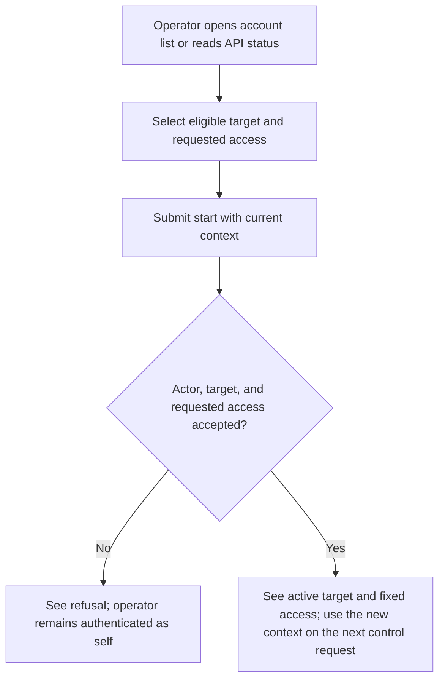
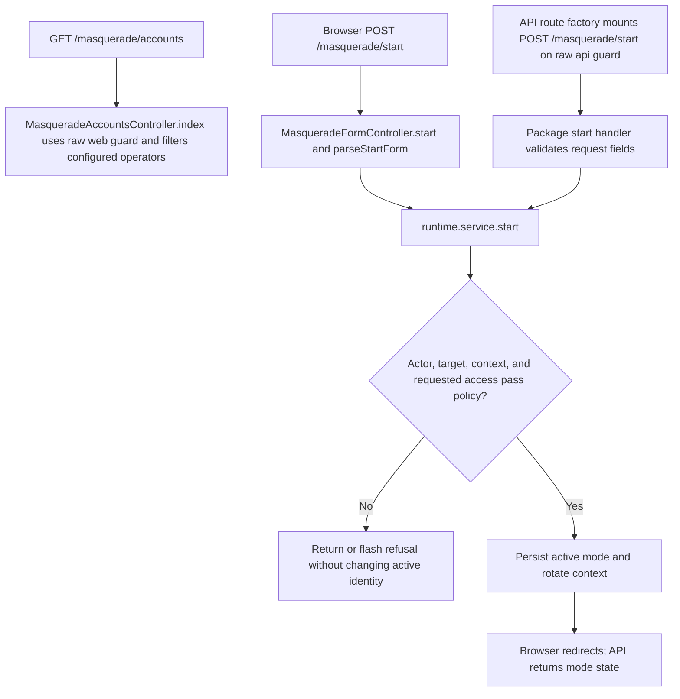

# US-MASQ-01 — Start a support mode

As a configured support operator, I want to start a time-limited mode for an eligible account so that I can inspect it without acquiring its credentials.

**Status:** Current when the configured actor and target policies allow it; source-reviewed, not runtime-tested here.
**Access:** Raw signed-in actor must be listed by `MASQUERADE_OPERATOR_EMAILS`; the target must be a different non-operator with an active, unrestricted native account. The API additionally requires an admitted target. API control endpoints use the raw bearer `api` guard independently of `ACCOUNT_KIT_AUTH_STRATEGY`; access tokens also need the `masquerade` ability.
**Entry:** Browser kits: open `/masquerade/accounts` and choose `Act as <email>`; API: read `GET /masquerade`, then `POST /masquerade/start` with its current context.
**Documentation:** [Masquerade browser/API walkthrough](../../docs/cookbook/masquerade-with-access-control.md), [API request example](../../apps/api/README.md#api).
**Source:** [Hypermedia target list](../../apps/hypermedia/app/controllers/masquerade_accounts_controller.ts), [form transition](../../apps/hypermedia/app/controllers/masquerade_form_controller.ts), [API control mount](../../apps/api/start/masquerade_routes.ts), [policy config](../../apps/api/config/masquerade.ts).
**Coverage:** [API Masquerade tests](../../apps/api/tests/functional/masquerade.spec.ts), [browser Masquerade tests](../../apps/hypermedia/tests/browser/masquerade.spec.ts).

## Acceptance criteria

| Kit                    | Field or key                | Control                                                  | Required/default/conditions                                                                                                                |
| ---------------------- | --------------------------- | -------------------------------------------------------- | ------------------------------------------------------------------------------------------------------------------------------------------ |
| Hypermedia, React, Vue | Target account (`targetId`) | Hidden value paired with visible `Act as <email>` button | Required; choices come from accounts ordered by email, excluding configured operators; server rejects actor's own ID                       |
| Hypermedia, React, Vue | Access (`access`)           | Select                                                   | `View only` (`view`) default; `Can edit` (`edit`) accepted only when `canEdit` returns literal `true`                                      |
| Hypermedia, React, Vue | `_masqueradeContext`        | Hidden field                                             | Current token rendered with the form; Shield CSRF also applies                                                                             |
| API                    | `targetId`                  | JSON value                                               | Required string or safe integer; canonical nonempty string, at most 255 characters, cannot equal actor ID                                  |
| API                    | `reason`                    | JSON value                                               | Optional in this kit; absent/null/blank stores null, otherwise trimmed and normalized to 1–500 Unicode code points and at most 2,000 bytes |
| API                    | `durationSeconds`           | JSON number                                              | Optional; defaults to configured duration; package default is 900 seconds; integer 60 through configured maximum (default max 3600)        |
| API                    | `access`                    | JSON enum                                                | Optional; `view` default or `edit`; edit requires `canEdit` to return literal `true`                                                       |
| API                    | `X-Masquerade-Context`      | Request header                                           | Current token from status; API token must have the `masquerade` ability                                                                    |

- API control body is limited to 8 KiB and accepts JSON or URL-encoded form fields; multipart and unknown keys are refused. URL form duration must be a canonical safe integer string; explicit JSON `null` is invalid.
- Browser form exposes no reason or duration field; its duration is service-configured. All kits retain the actor's own credential and return a fresh context after successful start.
- All kits refuse self-targets, operator targets, and inactive or restricted native accounts. Browser `canMasquerade` requires the configured operator pair; API `canMasquerade` also requires `AccountAdmission.isAdmitted(target.id)`.
- The `view` access is the default. A requested `edit` is accepted only when `canEdit` returns literal `true`; denied edit requests fail instead of silently becoming view. API token control requires the `masquerade` ability and a current context.

## User flow

## Code flow

Scope: browser form and API route-factory paths converge on the shared start service. Control routes authenticate the raw operator; business guards resolve effective identity on later requests.

**Code references:** [Hypermedia routes](../../apps/hypermedia/start/routes.ts), [Hypermedia target list](../../apps/hypermedia/app/controllers/masquerade_accounts_controller.ts), [Hypermedia form](../../apps/hypermedia/resources/views/pages/masquerade/accounts.edge), [React page](../../apps/inertia-react/inertia/pages/masquerade/accounts.tsx), [Vue page](../../apps/inertia-vue/inertia/pages/masquerade/accounts.vue), [API routes](../../apps/api/start/masquerade_routes.ts), [API config](../../apps/api/config/masquerade.ts), [API route tests](../../apps/api/tests/functional/masquerade.spec.ts), [browser tests](../../apps/hypermedia/tests/browser/masquerade.spec.ts).
