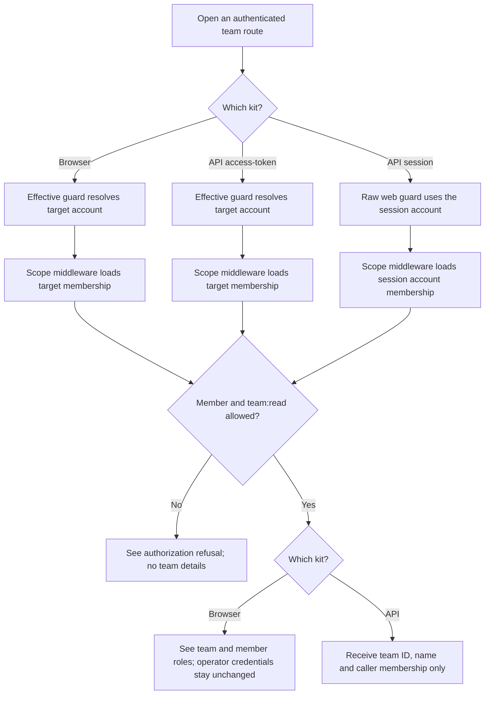
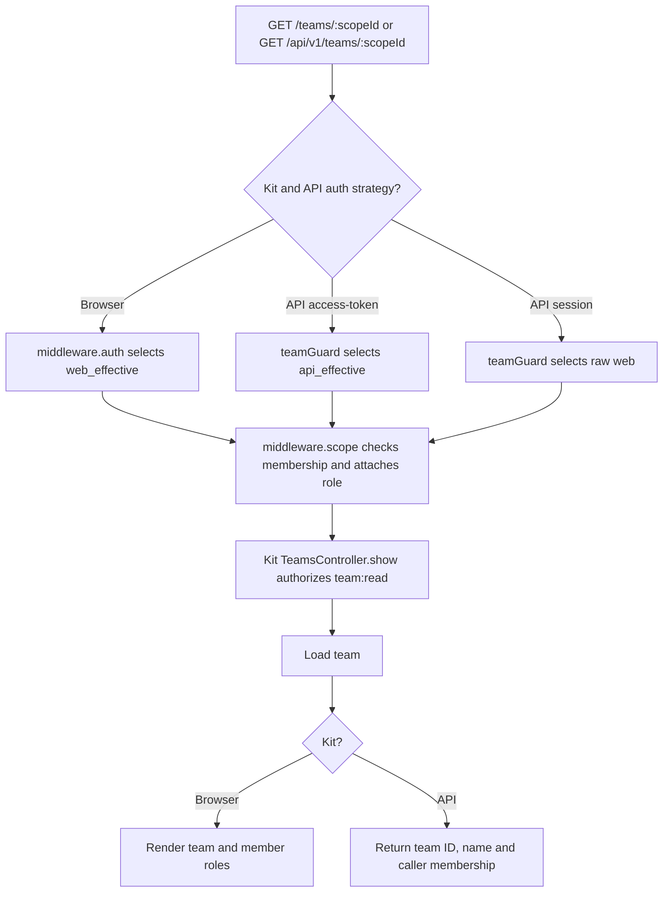

# US-MASQ-02 — View a team as the effective target

As a configured support operator, I want to inspect a team using the target account's membership so that my read access matches that account while my own credential remains unchanged.

**Status:** Current for browser sessions and the API kit's access-token strategy; API session strategy selects raw `web` for team routes.
**Access:** Browser kits and API access-token strategy require admitted mode, target membership and `team:read`; API access tokens also need the `masquerade` ability. API session strategy requires the admitted session account and uses raw `web`, checking its membership rather than the target's. A safe GET does not require a fresh mutation context header.
**Entry:** Browser kits: open `GET /teams/:scopeId` during a mode; API: request `GET /api/v1/teams/:scopeId`.
**Documentation:** [Resolve team membership for the effective account](../../docs/cookbook/masquerade-with-access-control.md#resolve-team-membership-for-the-effective-account), [API kit](../../apps/api/README.md#api).
**Source:** [Hypermedia effective guard selection](../../apps/hypermedia/config/auth.ts), [API team strategy and route guard](../../apps/api/start/routes.ts), [browser TeamsController.show](../../apps/hypermedia/app/controllers/teams_controller.ts), [API TeamsController.show](../../apps/api/app/controllers/teams_controller.ts).
**Coverage:** [API team and Masquerade tests](../../apps/api/tests/functional/masquerade_access_control.spec.ts).

## Acceptance criteria

- There is no editable input for a team read; the team ID comes from the route and membership is loaded by route middleware.
- In Hypermedia, React and Vue, the default `web_effective` guard resolves the admitted target for covered team routes. In API access-token strategy, `teamGuard` selects `api_effective`; if API auth strategy is `session`, `teamGuard` selects raw `web` and this API route does not act as the target.
- Scope middleware runs after auth and before the controller; it refuses a nonmember and attaches the member role. Both controllers check `team:read`. Browser kits return the team with its member roles; the API returns the team ID and name with only the caller's membership.
- API access-token requests need the `masquerade` ability. A current context token is required on unsafe covered mutations, not on this safe GET. An expired or invalidated mode refuses the triggering request; it does not retry under the operator identity or silently read as the target.

## User flow

## Code flow

Scope: browser effective-session guard and API team route through membership scope and team read. API session strategy uses raw `web` for this route.

**Code references:** [Hypermedia route](../../apps/hypermedia/start/routes.ts), [Hypermedia auth config](../../apps/hypermedia/config/auth.ts), [API route and `teamGuard`](../../apps/api/start/routes.ts), [API auth config](../../apps/api/config/auth.ts), [Hypermedia team controller](../../apps/hypermedia/app/controllers/teams_controller.ts), [API team controller](../../apps/api/app/controllers/teams_controller.ts), [Access Control config](../../apps/hypermedia/config/access_control.ts), [API tests](../../apps/api/tests/functional/masquerade_access_control.spec.ts), [React route](../../apps/inertia-react/start/routes.ts), [Vue route](../../apps/inertia-vue/start/routes.ts).
