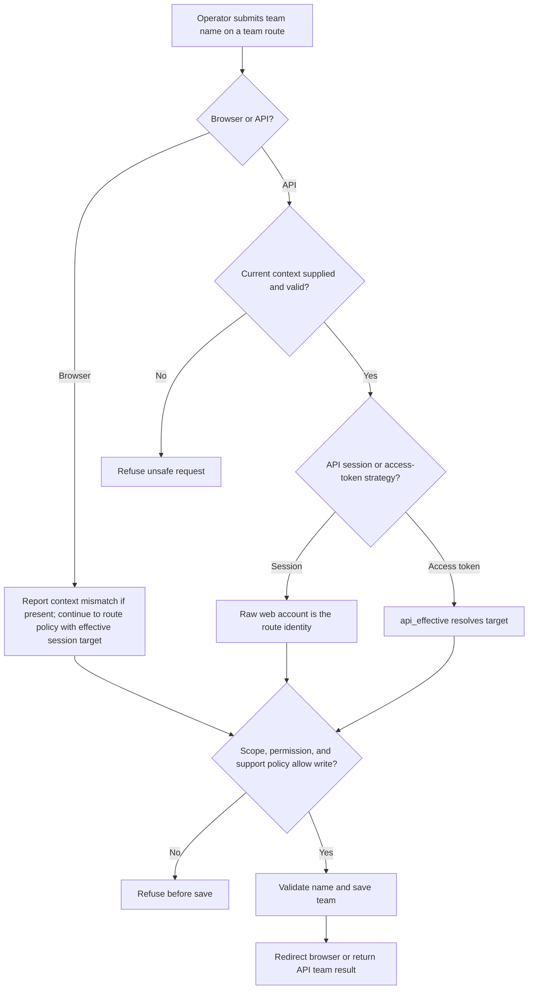
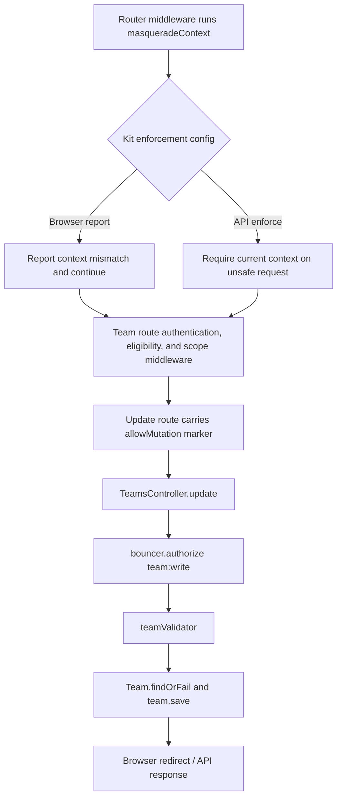

# US-MASQ-03 — Rename a team during support

As a configured support operator, I want to rename a team through an allowed target identity so that the write follows the target's actual team permission and the host's support policy.

**Status:** Current; source-reviewed, not runtime-tested here.
**Access:** Browser uses the effective session target and report-only context enforcement; target needs `team:write`, active mode must be edit, and the route must allow mutations. API enforces current context on unsafe requests; access-token strategy uses `api_effective`, while session strategy uses raw `web`.
**Entry:** Browser kits: `POST /teams/:scopeId`; API: `PATCH /api/v1/teams/:scopeId`.
**Documentation:** [Masquerade and team scope guide](../../docs/cookbook/masquerade-with-access-control.md#keep-team-permissions-in-force).
**Source:** [Hypermedia team routes](../../apps/hypermedia/start/routes.ts), [API team routes](../../apps/api/start/routes.ts).
**Coverage:** [Masquerade access-control tests](../../apps/api/tests/functional/masquerade_access_control.spec.ts); this link identifies source behavior coverage, not runtime verification of these docs.

## Acceptance criteria

| Field           | Control                                                 | Required/default/conditions                                                                                                            |
| --------------- | ------------------------------------------------------- | -------------------------------------------------------------------------------------------------------------------------------------- |
| Team name       | Text input / JSON string                                | Required; trimmed; 1–100 characters.                                                                                                   |
| Support context | Browser session context / `X-Masquerade-Context` header | Browser reports context mismatches and continues policy checks; API enforces current context on unsafe requests, including while idle. |
| Team scope      | Route ID and server-loaded membership                   | Caller must belong to the team and have `team:write` under the applicable guard.                                                       |

- The route resolves authentication, account eligibility, and team scope before `TeamsController.update` runs. The controller authorizes `team:write`, validates the name, loads the team, and saves it.
- Browser effective identity is the target during support mode. In API token mode, the effective guard is `api_effective`; in session mode, the configured team guard is raw `web`.
- During browser support, a context mismatch is logged in report mode and does not by itself refuse the rename; the active mode must still be edit, the route must carry `allowMutation()`, and the effective target must have `team:write`.
- API enforces current context on every unsafe request, including while idle. A mismatch is refused. In access-token mode the target is effective; in session mode the route identity remains raw `web`. In active token mode, edit access, the route marker, and target permission are also required. A view mode, sensitive route, absent membership, missing permission, or invalid name does not change the team.
- Browser redirects to the team page with confirmation; API returns the renamed team ID and name.

## User flow

## Code flow

**Code references:** [Hypermedia routes and allowMutation marker](../../apps/hypermedia/start/routes.ts), [Hypermedia Masquerade config](../../apps/hypermedia/config/masquerade.ts), [Hypermedia context middleware](../../apps/hypermedia/app/middleware/masquerade_context_middleware.ts), [Hypermedia team controller](../../apps/hypermedia/app/controllers/teams_controller.ts), [API routes and teamGuard](../../apps/api/start/routes.ts), [API Masquerade config](../../apps/api/config/masquerade.ts), [API context middleware](../../apps/api/app/middleware/masquerade_context_middleware.ts), [API auth strategy](../../apps/api/app/services/auth_strategy.ts), [API team controller](../../apps/api/app/controllers/teams_controller.ts), [Masquerade access-control tests](../../apps/api/tests/functional/masquerade_access_control.spec.ts), [Inertia React route/controller](../../apps/inertia-react/start/routes.ts), [React Masquerade config](../../apps/inertia-react/config/masquerade.ts), [React controller](../../apps/inertia-react/app/controllers/teams_controller.ts), [Inertia Vue route/controller](../../apps/inertia-vue/start/routes.ts), [Vue Masquerade config](../../apps/inertia-vue/config/masquerade.ts), [Vue controller](../../apps/inertia-vue/app/controllers/teams_controller.ts).
