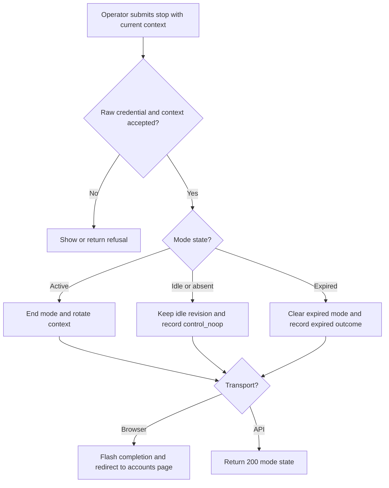
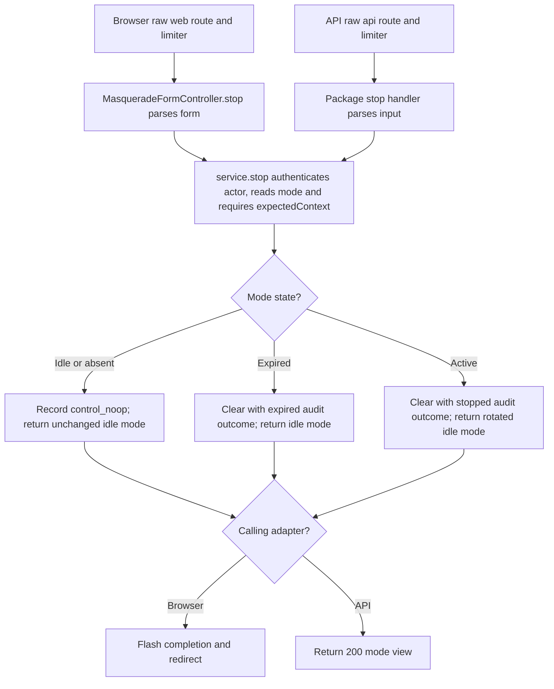

# US-MASQ-04 — Stop a support mode

As a configured support operator, I want to end the active mode so that subsequent business requests use my operator identity again.

**Status:** Current; source-reviewed, not runtime-tested here.
**Access:** Authenticated raw operator; an API access token needs the `masquerade` ability. Business target credentials are not used to stop the mode.
**Entry:** Browser kits: `POST /masquerade/stop`; API: `POST /masquerade/stop` with the current `X-Masquerade-Context` from `GET /masquerade`.
**Documentation:** [Masquerade API walkthrough](../../apps/api/README.md#api).
**Source:** [Hypermedia stop form](../../apps/hypermedia/resources/views/pages/masquerade/accounts.edge), [Hypermedia controller](../../apps/hypermedia/app/controllers/masquerade_form_controller.ts), [API route mount](../../apps/api/start/masquerade_routes.ts).
**Coverage:** [API Masquerade tests](../../apps/api/tests/functional/masquerade.spec.ts), [browser Masquerade tests](../../apps/hypermedia/tests/browser/masquerade.spec.ts); links identify source behavior coverage, not runtime verification of these docs.

## Acceptance criteria

| Field   | Control                                                                | Required/default/conditions                                |
| ------- | ---------------------------------------------------------------------- | ---------------------------------------------------------- |
| Context | Hidden `_masqueradeContext` form value / `X-Masquerade-Context` header | Current token; browser form also uses the host CSRF token. |

- Browser route runs on the raw operator session. API control route authenticates with the raw API guard and applies its stop limiter.
- With a valid context and an idle or absent mode, the service returns idle without changing revision and records `control_noop` in the audit trail. API responds `200` with mode state; the browser adapter flashes completion and redirects. The audit outcome is not an additional response field.
- For an active mode, the service ends it and rotates context. An expired mode is cleared with an expired audit outcome instead of a normal stopped outcome. Browser success redirects to `/masquerade/accounts`; API returns `200` mode state.
- Both browser and API controls refuse missing or stale context, regardless of the browser's report setting for business requests. After a lost response, refresh `GET /masquerade` before another control action.
- Stopping support does not sign the operator out or issue the target's credential.

## User flow

## Code flow

**Code references:** [Hypermedia routes](../../apps/hypermedia/start/routes.ts), [Hypermedia form](../../apps/hypermedia/resources/views/pages/masquerade/accounts.edge), [Hypermedia controller](../../apps/hypermedia/app/controllers/masquerade_form_controller.ts), [Hypermedia limiter setup](../../apps/hypermedia/start/masquerade_limiter.ts), [API route factory setup](../../apps/api/start/masquerade_routes.ts), [API limiter setup](../../apps/api/start/masquerade_limiter.ts), [API tests](../../apps/api/tests/functional/masquerade.spec.ts), [Inertia React route/controller](../../apps/inertia-react/start/routes.ts), [React controller](../../apps/inertia-react/app/controllers/masquerade_form_controller.ts), [Inertia Vue route/controller](../../apps/inertia-vue/start/routes.ts), [Vue controller](../../apps/inertia-vue/app/controllers/masquerade_form_controller.ts).
