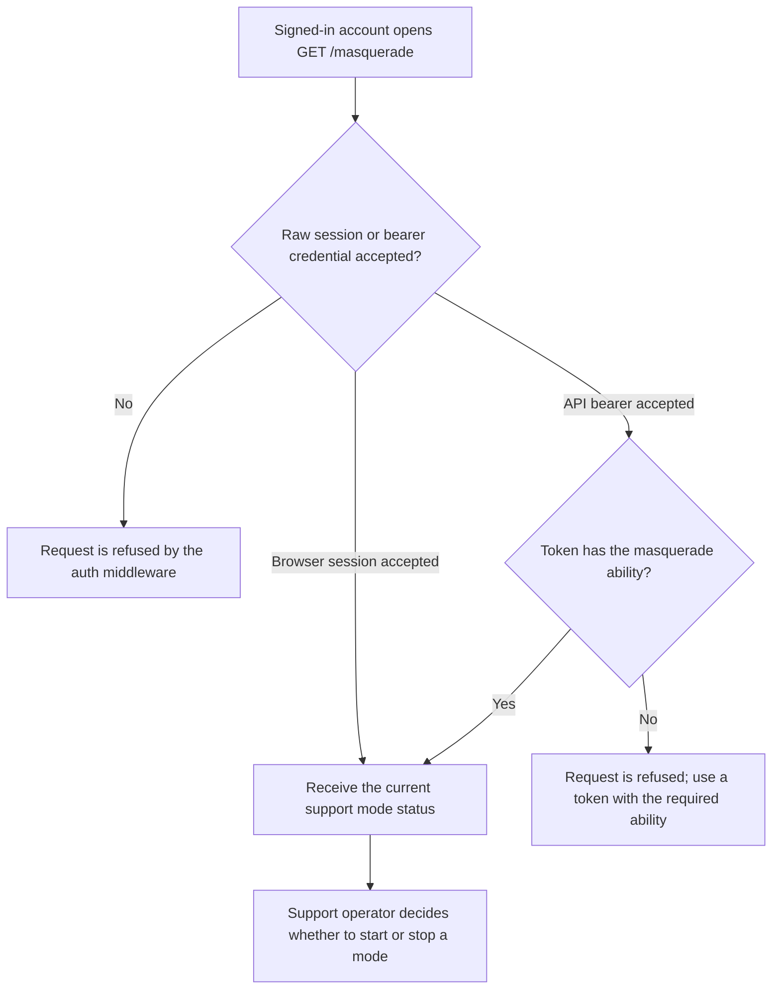
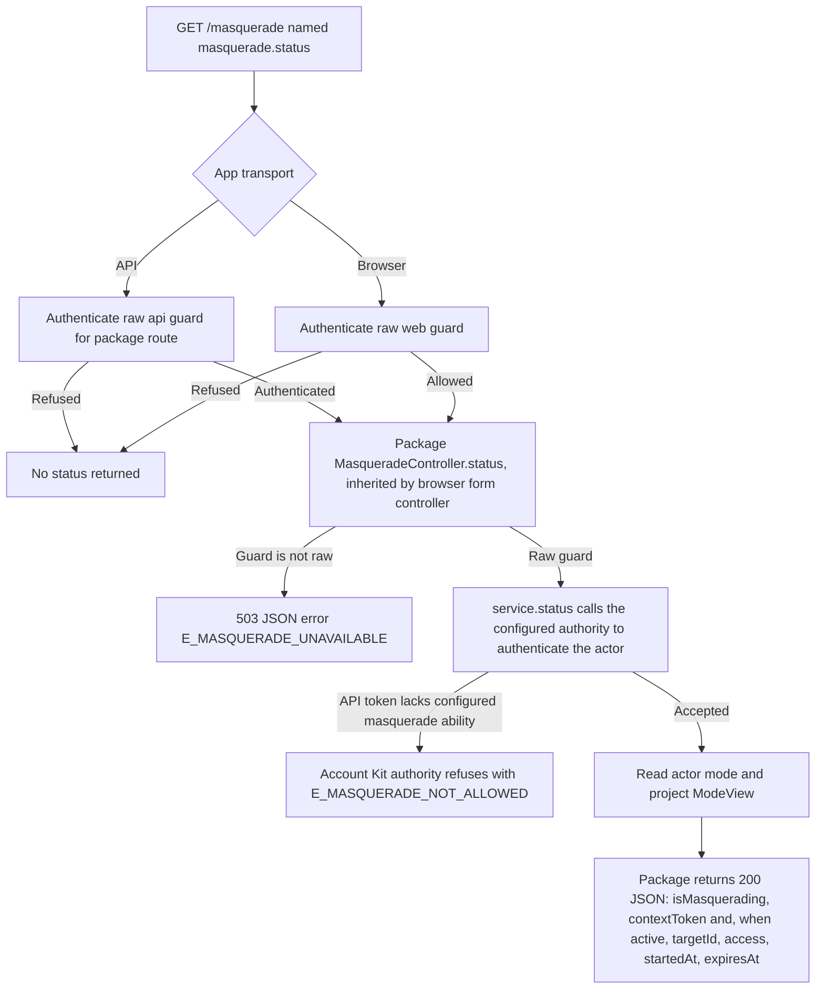

# US-MASQ-05 — Read the support mode status

As a signed-in account, I want to read the current support mode status so that I can see whether a mode is active; a support operator uses it before starting or stopping one.

**Status:** Current in the browser kits and API access-token starter; source-reviewed, not runtime-tested here. The response is read from `@kevinjohn/adonisjs-masquerade` 0.7.0 `http/controllers.ts`, `src/service.ts`, `src/mode_projection.ts` and `src/types.ts`.
**Access:** Authenticated raw `web` session in browser kits or raw `api` bearer token with the `masquerade` ability in the API kit. The API ability check belongs to the configured Account Kit authority, which the status service calls after raw route authentication. The status action does not require operator membership.
**Entry:** `GET /masquerade` in browser and API kits (route name `masquerade.status`). The operator page at `/masquerade/accounts` reads the same status through the Masquerade service.
**Documentation:** [Masquerade with Access Control](../../docs/cookbook/masquerade-with-access-control.md).
**Source:** [Hypermedia Masquerade routes](../../apps/hypermedia/start/masquerade_routes.ts), [Hypermedia form controller](../../apps/hypermedia/app/controllers/masquerade_form_controller.ts), [Hypermedia accounts controller](../../apps/hypermedia/app/controllers/masquerade_accounts_controller.ts), [Hypermedia exception handler](../../apps/hypermedia/app/exceptions/handler.ts); `@kevinjohn/adonisjs-masquerade` 0.7.0 `http/controllers.ts`, `src/service.ts`, `src/mode_projection.ts`, `src/types.ts`, `src/context_token.ts`, `src/errors.ts`, `src/request_exception.ts`.
**Coverage:** [API Masquerade tests](../../apps/api/tests/functional/masquerade.spec.ts) read `GET /masquerade` on the API kit; the [Hypermedia functional test](../../apps/hypermedia/tests/functional/masquerade.spec.ts) reads `GET /masquerade` as a non-operator customer and takes `contextToken` from the JSON response.

## Acceptance criteria

- There are no input fields. Browser callers use the raw session; API callers use the raw bearer credential.
- The route is handled by `MasqueradeFormController.status`, which the kit inherits from the package controller and does not override.
- The package controller answers HTTP 200 with a JSON body, with `Cache-Control: no-store` and `Vary: Accept, X-Masquerade-Context` (`@kevinjohn/adonisjs-masquerade` 0.7.0 `http/controllers.ts`).
- With no active mode the body is `{ "isMasquerading": false, "contextToken": "<token>" }`.
- With an active mode the body also has `targetId` (the target account ID), `access` (`"view"` or `"edit"`), `startedAt` and `expiresAt` (strings), plus `isMasquerading: true` and `contextToken` (`@kevinjohn/adonisjs-masquerade` 0.7.0 `src/mode_projection.ts`, `src/types.ts`).
- `contextToken` has the form `<revision>.<hex>`, is derived from the mode row or, when none exists, from the actor, and is the value the start and stop forms submit as the expected context (`@kevinjohn/adonisjs-masquerade` 0.7.0 `src/context_token.ts`).
- The route reads the status only; the service does not change the mode. The request is refused with `E_MASQUERADE_UNAVAILABLE` when the matched guard is not the raw operator guard. The kit's exception handler does not special-case the error and passes it to `super.handle`; the error's own `handle` method (`@kevinjohn/adonisjs-masquerade` 0.7.0 `src/errors.ts`, `src/request_exception.ts`) responds with HTTP 503 with `Cache-Control: no-store`, `Vary: Accept, X-Masquerade-Context` and the JSON body `{ "errors": [{ "code": "E_MASQUERADE_UNAVAILABLE", "message": "Masquerade is unavailable" }] }`; when the request has an i18n instance, the message is its `errors.E_MASQUERADE_UNAVAILABLE` translation with that English fallback.
- The kit's accounts page renders the same mode state, including the context token its start and stop forms submit; see [US-MASQ-01](us-masq-01-start-support-mode.md) and [US-MASQ-04](us-masq-04-stop-support-mode.md).
- The API kit exposes the same path through the package route factory with its raw bearer guard, as used in the start and stop stories.

## User flow

## Code flow

Scope: browser and API route authentication through the shared package status action and its response.

**Code references:** [Hypermedia routes](../../apps/hypermedia/start/masquerade_routes.ts), [React routes](../../apps/inertia-react/start/masquerade_routes.ts), [Vue routes](../../apps/inertia-vue/start/masquerade_routes.ts), [Hypermedia form controller](../../apps/hypermedia/app/controllers/masquerade_form_controller.ts), [Hypermedia accounts controller](../../apps/hypermedia/app/controllers/masquerade_accounts_controller.ts), [API routes](../../apps/api/start/masquerade_routes.ts), [API authority configuration](../../apps/api/config/masquerade.ts#L14), [Masquerade Account Kit authority](https://github.com/Kevinjohn/oss-adonisjs-masquerade/blob/v0.7.0/account_kit/main.ts#L229-L268), [Masquerade 0.7.0 status controller](https://github.com/Kevinjohn/oss-adonisjs-masquerade/blob/v0.7.0/http/controllers.ts).
