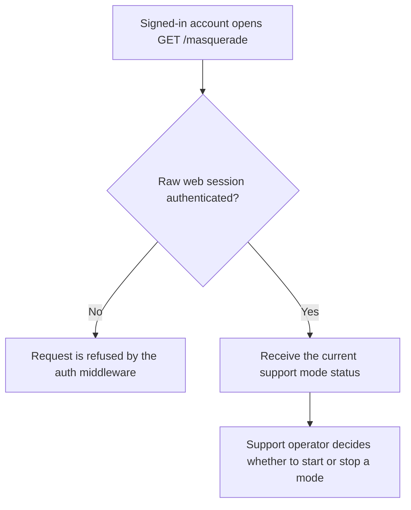
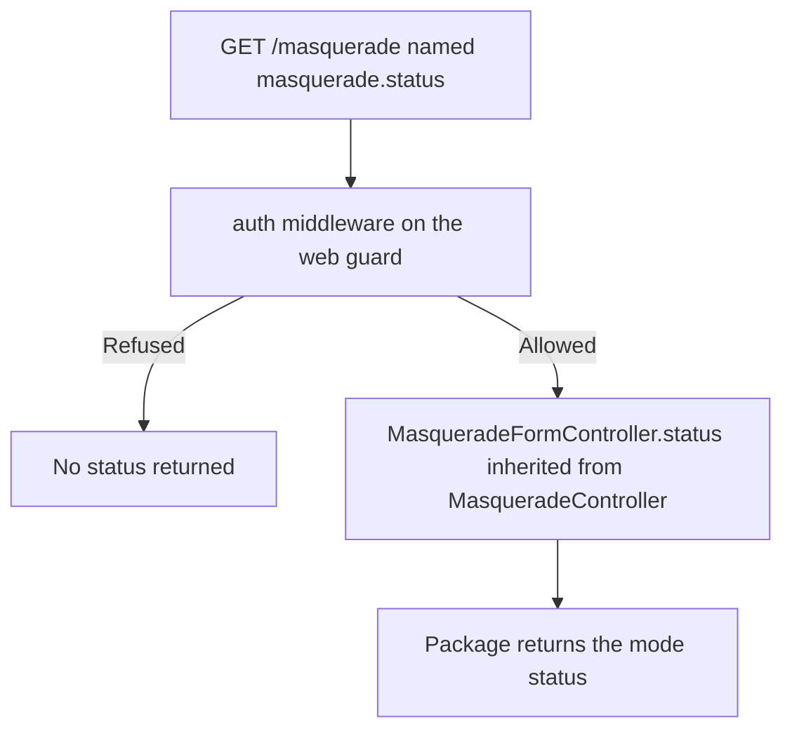

# US-MASQ-05 — Read the support mode status in a browser kit

As a signed-in account, I want to read the current support mode status so that I can see whether a mode is active; a support operator uses it before starting or stopping one.

**Status:** Current in the browser kits; source-reviewed, not runtime-tested here. The response body is produced by the Masquerade package controller, whose source is not installed in this checkout, so its fields are not recorded here beyond `contextToken`, which the Hypermedia functional test reads.
**Access:** Any authenticated account on the `web` guard; the route does not check operator membership.
**Entry:** Browser kits: `GET /masquerade` (route name `masquerade.status`). The operator page at `/masquerade/accounts` reads the same status through the Masquerade service.
**Documentation:** [Masquerade with Access Control](../../docs/cookbook/masquerade-with-access-control.md).
**Source:** [Hypermedia Masquerade routes](../../apps/hypermedia/start/masquerade_routes.ts), [Hypermedia form controller](../../apps/hypermedia/app/controllers/masquerade_form_controller.ts), [Hypermedia accounts controller](../../apps/hypermedia/app/controllers/masquerade_accounts_controller.ts).
**Coverage:** [API Masquerade tests](../../apps/api/tests/functional/masquerade.spec.ts) read `GET /masquerade` on the API kit; the [Hypermedia functional test](../../apps/hypermedia/tests/functional/masquerade.spec.ts) reads `GET /masquerade` as a non-operator customer and takes `contextToken` from the JSON response.

## Acceptance criteria

- There are no input fields; the request needs a raw `web` session; operator membership is not checked.
- The route is handled by `MasqueradeFormController.status`, which the kit inherits from the package controller and does not override.
- The kit's accounts page renders the same mode state, including the context token its start and stop forms submit; see [US-MASQ-01](us-masq-01-start-support-mode.md) and [US-MASQ-04](us-masq-04-stop-support-mode.md).
- The API kit exposes the same path through the package route factory with its raw bearer guard, as used in the start and stop stories.

## User flow

## Code flow

Scope: browser-kit route, middleware and inherited controller action; the status payload is built inside the package.

**Code references:** [Hypermedia routes](../../apps/hypermedia/start/masquerade_routes.ts), [React routes](../../apps/inertia-react/start/masquerade_routes.ts), [Vue routes](../../apps/inertia-vue/start/masquerade_routes.ts), [Hypermedia form controller](../../apps/hypermedia/app/controllers/masquerade_form_controller.ts), [Hypermedia accounts controller](../../apps/hypermedia/app/controllers/masquerade_accounts_controller.ts), [API routes](../../apps/api/start/masquerade_routes.ts).
