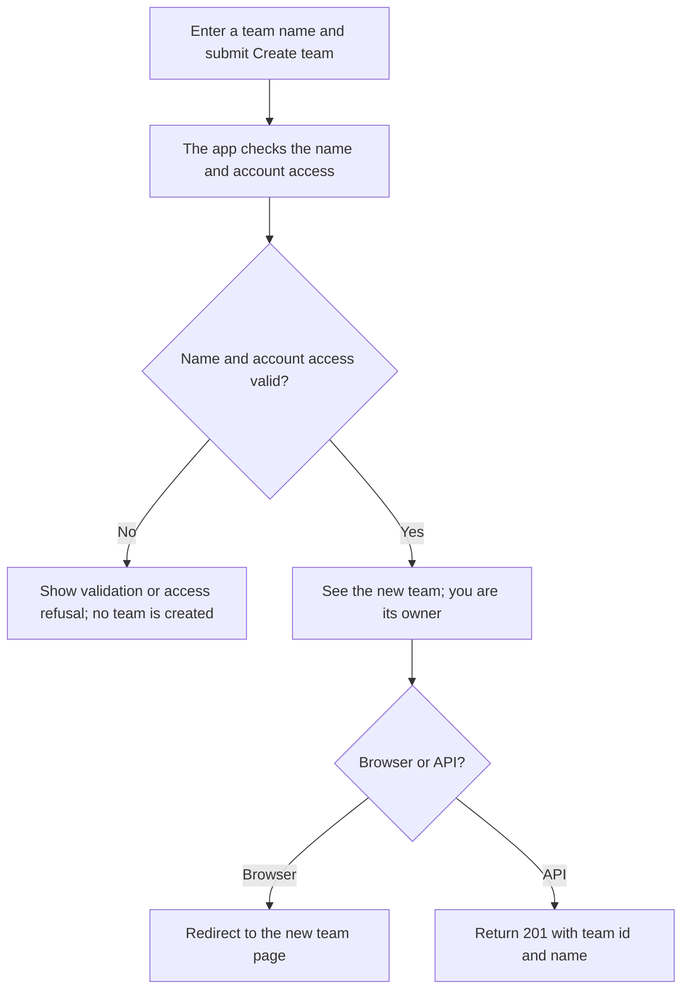
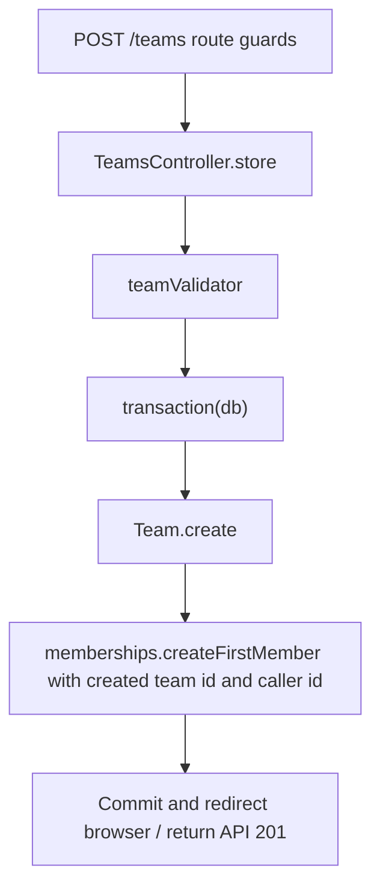

# US-TEAM-01 — Create a team

As an eligible signed-in account holder, I want to create a team and become its owner so that I can invite people and manage team work.

**Status:** Current; source-reviewed, not runtime-tested here.
**Access:** Browser: verified account on the raw `web` guard, outside masquerade; API: selected account guard and admitted-account middleware. The account-kit blocker applies.
**Entry:** Browser kits: `POST /teams`; API: `POST /api/v1/teams`.
**Documentation:** [Hypermedia team list](../../apps/hypermedia/resources/views/pages/teams/index.edge).
**Source:** [Hypermedia routes](../../apps/hypermedia/start/routes.ts), [API routes](../../apps/api/start/routes.ts).
**Coverage:** [Team functional tests](../../apps/api/tests/functional/teams.spec.ts); this link identifies source behavior coverage, not runtime verification of these docs.

## Acceptance criteria

| Field                                        | Control                  | Required/default/conditions          |
| -------------------------------------------- | ------------------------ | ------------------------------------ |
| Team name (visible label) / `name` (API key) | Text input / JSON string | Required; trimmed; 1–100 characters. |

- Invalid names return validation feedback and do not create a team.
- A valid name creates a team and the caller's owner membership in the same database transaction. A failure in either write leaves no team without its owner membership.
- Browser redirects to the new team's page. API returns `201` with the team's `id` and `name`.
- API caller must be admitted; in `session` strategy the selected guard is raw `web`, and in `access_tokens` strategy it is `api`. The API account-kit blocker prevents this native account action during masquerade.

## User flow

## Code flow

**Code references:** [Hypermedia route and guards](../../apps/hypermedia/start/routes.ts), [Hypermedia controller](../../apps/hypermedia/app/controllers/teams_controller.ts), [Hypermedia validator](../../apps/hypermedia/app/validators/team.ts), [API route and guards](../../apps/api/start/routes.ts), [API controller](../../apps/api/app/controllers/teams_controller.ts), [API validator](../../apps/api/app/validators/account_kit.ts), [Team functional tests](../../apps/api/tests/functional/teams.spec.ts), [Inertia React controller](../../apps/inertia-react/app/controllers/teams_controller.ts), [Inertia Vue controller](../../apps/inertia-vue/app/controllers/teams_controller.ts).
