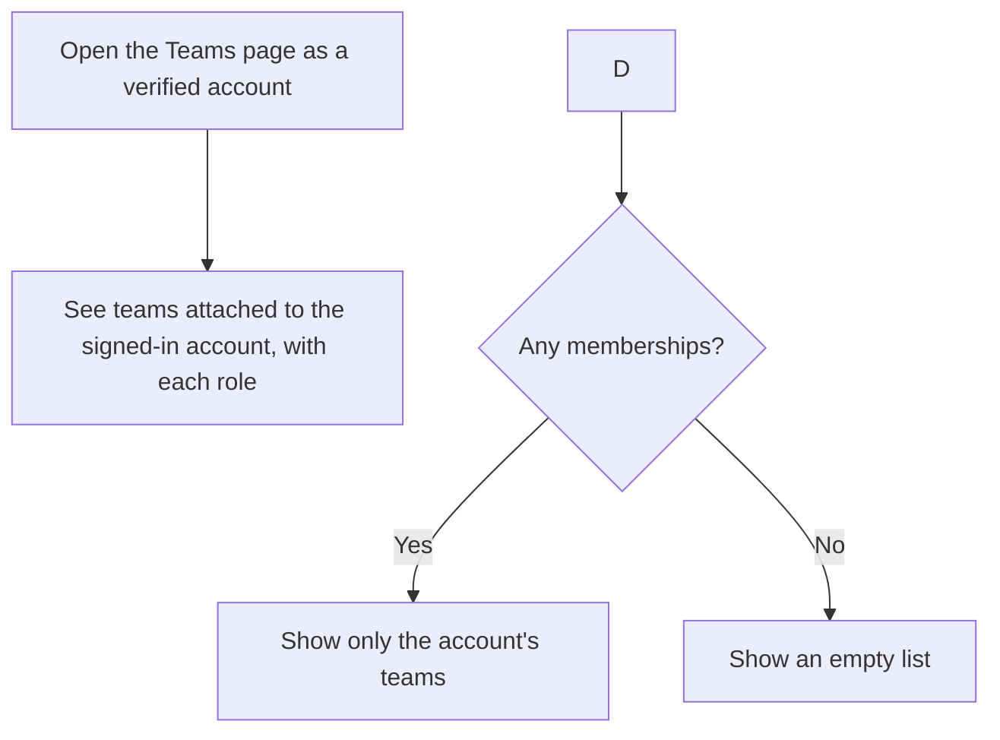
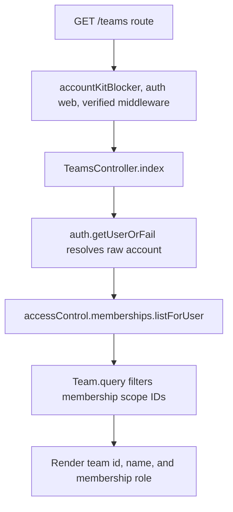

# US-TEAM-02 — List my teams

As a verified account owner, I want to list the teams attached to my account so that I can choose a team to open.

**Status:** Current; source-reviewed, not runtime-tested here.
**Access:** Browser kits only; verified account on raw `web` guard. The account-kit blocker keeps this native-account list unavailable during masquerade.
**Entry:** Browser kits: `GET /teams`.
**Documentation:** [Hypermedia team list](../../apps/hypermedia/resources/views/pages/teams/index.edge).
**Source:** [Hypermedia routes](../../apps/hypermedia/start/routes.ts), [Hypermedia TeamsController.index](../../apps/hypermedia/app/controllers/teams_controller.ts).
**Coverage:** [Browser team tests](../../apps/hypermedia/tests/browser/teams.spec.ts); this link identifies source behavior coverage, not runtime verification of these docs.

## Acceptance criteria

- There are no editable fields; the signed-in owner opens the teams page.
- The list contains only teams in the raw signed-in account's Access Control memberships and shows each membership role.
- An account with no memberships sees an empty list. Authentication, verification, or account-kit-blocker refusal is not rendered as an empty list.
- There is no API collection route for listing teams. The API kit exposes team detail by scope ID instead.

## User flow

## Code flow

**Code references:** [Hypermedia route and guards](../../apps/hypermedia/start/routes.ts), [Hypermedia controller](../../apps/hypermedia/app/controllers/teams_controller.ts), [Hypermedia team list](../../apps/hypermedia/resources/views/pages/teams/index.edge), [Inertia React route and controller](../../apps/inertia-react/start/routes.ts), [Inertia Vue route and controller](../../apps/inertia-vue/start/routes.ts), [Browser team tests](../../apps/hypermedia/tests/browser/teams.spec.ts).
