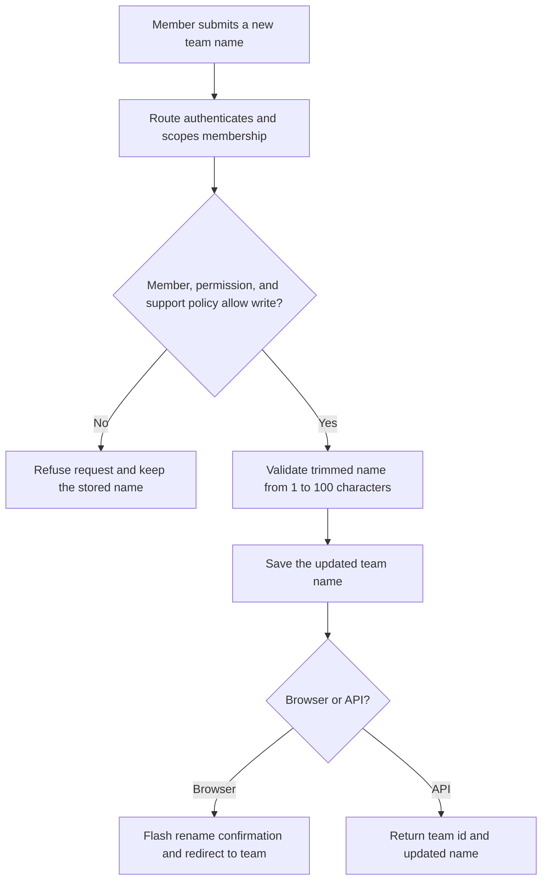
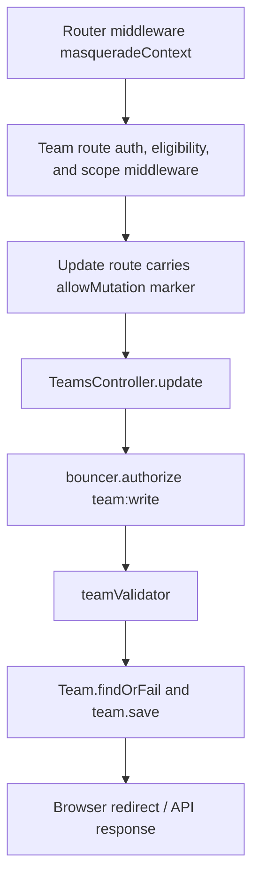

# US-TEAM-03 — Rename a team

As a team editor, I want to change a team name so that members see the updated name.

**Status:** Current; source-reviewed, not runtime-tested here.
**Access:** Browser requires a verified effective member with `team:write`. API requires admitted membership and `team:write`; its session strategy uses raw `web`, token strategy uses `api_effective` and a current context header on unsafe requests. During support mode, target permission and edit-mode mutation policy apply.
**Entry:** Browser kits: `POST /teams/:scopeId`; API: `PATCH /api/v1/teams/:scopeId`.
**Documentation:** [Masquerade and team scope guide](../../docs/cookbook/masquerade-with-access-control.md#keep-team-permissions-in-force).
**Source:** [Hypermedia team routes](../../apps/hypermedia/start/routes.ts), [API team routes](../../apps/api/start/routes.ts).
**Coverage:** [Team functional tests](../../apps/api/tests/functional/teams.spec.ts); this link identifies source behavior coverage, not runtime verification of these docs.

## Acceptance criteria

| Field           | Control                                                             | Required/default/conditions                                                                                                                                                                                             |
| --------------- | ------------------------------------------------------------------- | ----------------------------------------------------------------------------------------------------------------------------------------------------------------------------------------------------------------------- |
| Team name       | Text input / JSON string                                            | Required; defaults to the current team name in browser forms; trimmed; 1–100 characters.                                                                                                                                |
| Support context | Browser session context / `X-Masquerade-Context` for API token mode | API token strategy requires current context on unsafe requests, including while idle; browser kits check unsafe effective requests too, but their configured report mode logs context mismatch rather than refusing it. |
| CSRF            | Host form token                                                     | Required by the browser Shield middleware for the form submission.                                                                                                                                                      |

- The route resolves the member scope before the controller. The controller requires `team:write`, validates the name, loads the team, then saves it.
- A successful browser rename flashes “Team renamed.” and redirects to the team page; API returns `id` and updated `name`.
- Missing membership, unavailable `team:write`, invalid name, or denied support-mode mutation prevents the save. During support mode, the operator's permission alone is insufficient: the request must be marked mutable, the context enforcement configuration and edit policy apply, and the effective target must have permission.

## User flow

## Code flow

**Code references:** [Hypermedia team route and middleware](../../apps/hypermedia/start/routes.ts), [Hypermedia controller](../../apps/hypermedia/app/controllers/teams_controller.ts), [Hypermedia validator](../../apps/hypermedia/app/validators/team.ts), [API team route and middleware](../../apps/api/start/routes.ts), [API controller](../../apps/api/app/controllers/teams_controller.ts), [API validator](../../apps/api/app/validators/account_kit.ts), [Masquerade access-control guide](../../docs/cookbook/masquerade-with-access-control.md), [Team functional tests](../../apps/api/tests/functional/teams.spec.ts), [Inertia React controller](../../apps/inertia-react/app/controllers/teams_controller.ts), [Inertia Vue controller](../../apps/inertia-vue/app/controllers/teams_controller.ts).
