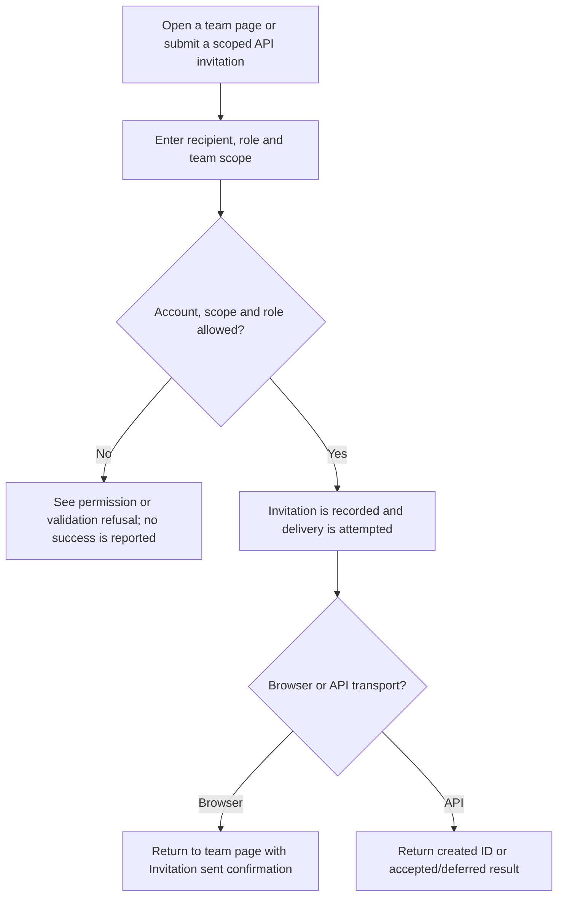
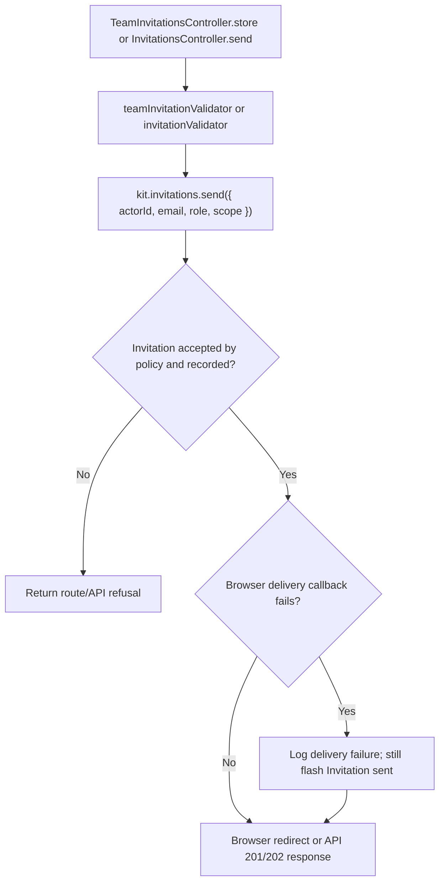

# US-TEAM-04 — Invite a person to a team

As a verified team member with invitation permission, I want to invite a person to a team so that they can join with an authorized role.

**Status:** Current; browser team form and API account-invitation route are source-reviewed.
**Access:** Browser: raw signed-in, verified account with scope membership; Account Kit blocker prevents this action during Masquerade. API: selected account guard, verified-account middleware and invitation ability/policy where applicable.
**Entry:** Browser kits: `POST /teams/:scopeId/invitations`; API: `POST /api/v1/account/invitations` with `scope` in the JSON body.
**Documentation:** [Keep invitations on the raw account](../../docs/cookbook/masquerade-with-access-control.md#keep-invitations-on-the-raw-account), [API account routes](../../apps/api/start/routes.ts).
**Source:** [TeamInvitationsController.store](../../apps/hypermedia/app/controllers/team_invitations_controller.ts), [API InvitationsController.send](../../apps/api/app/controllers/invitations_controller.ts).
**Coverage:** [API invitation tests](../../apps/api/tests/functional/account_invitations.spec.ts).

## Acceptance criteria

| Kit                    | Field or key    | Control     | Required/default/conditions                                                                                     |
| ---------------------- | --------------- | ----------- | --------------------------------------------------------------------------------------------------------------- |
| Hypermedia, React, Vue | Email (`email`) | Email input | Required; trimmed, lowercase, valid and at most 254 characters                                                  |
| Hypermedia, React, Vue | Role (`role`)   | Select      | Required; options are `viewer`, `editor`, `admin`; owner cannot be invited                                      |
| API                    | `email`         | JSON string | Required; normalized email, at most 254 characters                                                              |
| API                    | `role`          | JSON string | Required, nonempty after trim; Access Control invitation callback decides whether actor may invite to that role |
| API                    | `scope`         | JSON string | Required; positive integer team ID in normalized decimal form                                                   |

- Browser invitation remains tied to the raw signed-in account and route team; it does not inherit a Masquerade target's membership or permissions.
- API sends a scoped Account Kit invitation through `/account/invitations`; token clients also need the `invitations:create` ability. The server callback authorizes the requested role.
- Successful browser send redirects with `Invitation sent to <email>.`; if its delivery callback fails, the controller logs the failure but still shows that same flash. API returns `201` with invitation ID or `202` when delivery is deferred. Neither response proves an email arrived.
- Invalid email, scope, role permission or account eligibility is refused. For bearer API requests, the token also needs `invitations:create` ability.

## User flow

## Code flow

Scope: browser team-scoped form and API account invitation operation. The browser action derives scope from the route; API input supplies it explicitly.

**Code references:** [Hypermedia route](../../apps/hypermedia/start/routes.ts), [team invitation form](../../apps/hypermedia/resources/views/pages/teams/show.edge), [browser controller](../../apps/hypermedia/app/controllers/team_invitations_controller.ts), [browser validator](../../apps/hypermedia/app/validators/team.ts), [API route](../../apps/api/start/routes.ts), [API controller](../../apps/api/app/controllers/invitations_controller.ts), [API validator](../../apps/api/app/validators/account_kit.ts), [React route/controller](../../apps/inertia-react/start/routes.ts), [React form/controller](../../apps/inertia-react/app/controllers/team_invitations_controller.ts), [Vue route/controller](../../apps/inertia-vue/start/routes.ts), [Vue form/controller](../../apps/inertia-vue/app/controllers/team_invitations_controller.ts), [API invitation tests](../../apps/api/tests/functional/account_invitations.spec.ts).
