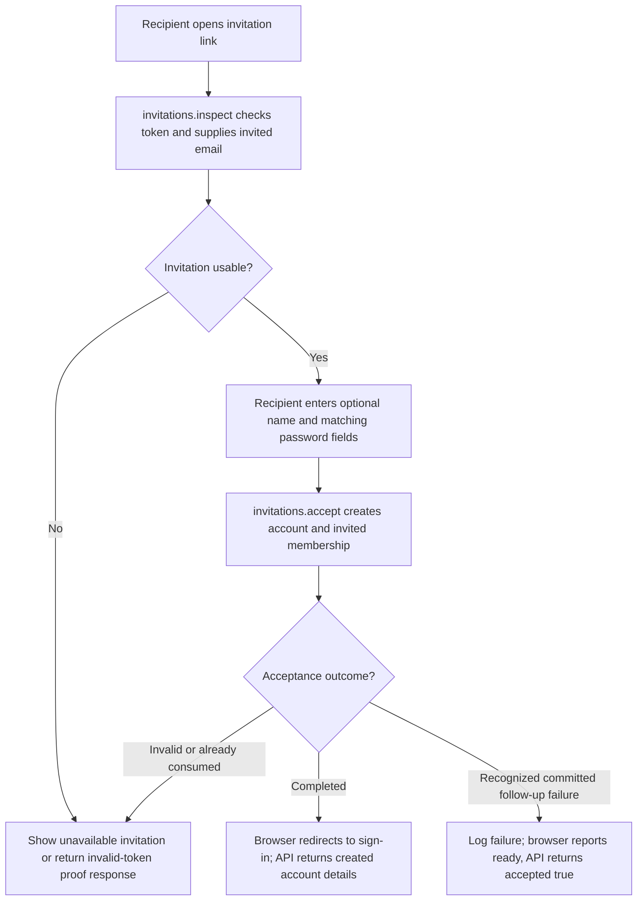
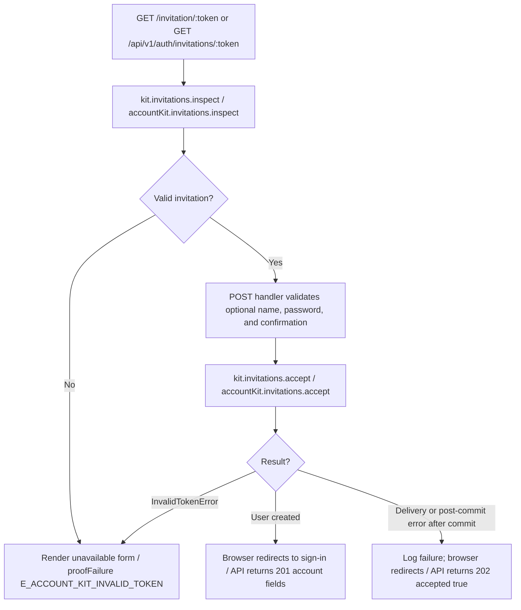

# US-TEAM-05 — Accept a team invitation

As an invitation recipient, I want to accept a valid invitation so that I can create my account and join the intended team with the role chosen by the inviter.

**Status:** Current; source-reviewed, not runtime-tested here.
**Access:** Public invitation link with valid, unexpired, unused token; the invited email is supplied by the invitation record.
**Entry:** Browser kits: `GET/POST /invitation/:token`; API: `GET/POST /api/v1/auth/invitations/:token`.
**Documentation:** [Hypermedia invitation page](../../apps/hypermedia/start/routes.ts).
**Source:** [Hypermedia routes](../../apps/hypermedia/start/routes.ts), [API routes](../../apps/api/start/routes.ts).
**Coverage:** [Invitation functional tests](../../apps/api/tests/functional/account_invitations.spec.ts); this link identifies source behavior coverage, not runtime verification of these docs.

## Acceptance criteria

| Field            | Control                      | Required/default/conditions                                                                             |
| ---------------- | ---------------------------- | ------------------------------------------------------------------------------------------------------- |
| Full name        | Text input / JSON string     | Optional; trimmed; maximum 255 characters.                                                              |
| Password         | Password input / JSON string | Required; 8–256 characters.                                                                             |
| Confirm password | Password input / JSON string | Required; must match Password.                                                                          |
| Token            | Link / URL parameter         | Required; valid, unexpired, unused; invited email is displayed from the invitation and is not editable. |

- Browser inspects the invitation before rendering the form. API `GET` returns invitation details for a valid token; proof responses use no-store/no-referrer headers.
- Valid acceptance creates the invited account and team membership with the role attached to the invitation. Browser redirects to sign-in; API returns `201` with user ID, email, and verification state.
- Invalid, expired, used, or concurrently consumed token does not create a second account or membership. Browser redirects to sign-in with invalid-link feedback; API returns `E_ACCOUNT_KIT_INVALID_TOKEN` proof failure.
- If a recognized delivery or post-commit failure follows committed acceptance, the browser logs it and still reports the account ready; API logs it and returns `202` with `accepted: true`.

## User flow

## Code flow

**Code references:** [Hypermedia invitation routes](../../apps/hypermedia/start/routes.ts), [Hypermedia controller](../../apps/hypermedia/app/controllers/invitations_controller.ts), [Hypermedia validator](../../apps/hypermedia/app/validators/team.ts), [API invitation routes](../../apps/api/start/routes.ts), [API controller](../../apps/api/app/controllers/invitations_controller.ts), [API validator](../../apps/api/app/validators/account_kit.ts), [Proof response headers](../../apps/api/app/services/http_responses.ts), [Invitation functional tests](../../apps/api/tests/functional/account_invitations.spec.ts), [Inertia React controller](../../apps/inertia-react/app/controllers/invitations_controller.ts), [Inertia Vue controller](../../apps/inertia-vue/app/controllers/invitations_controller.ts).
