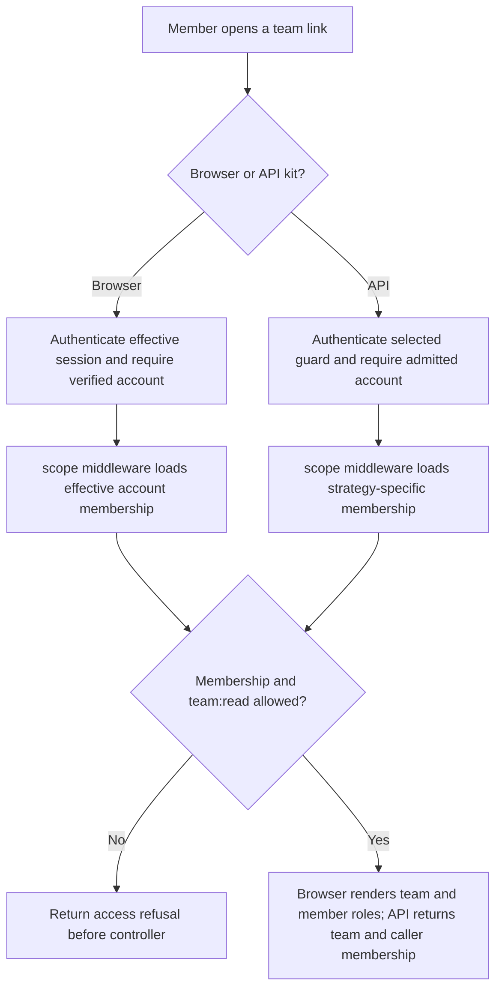
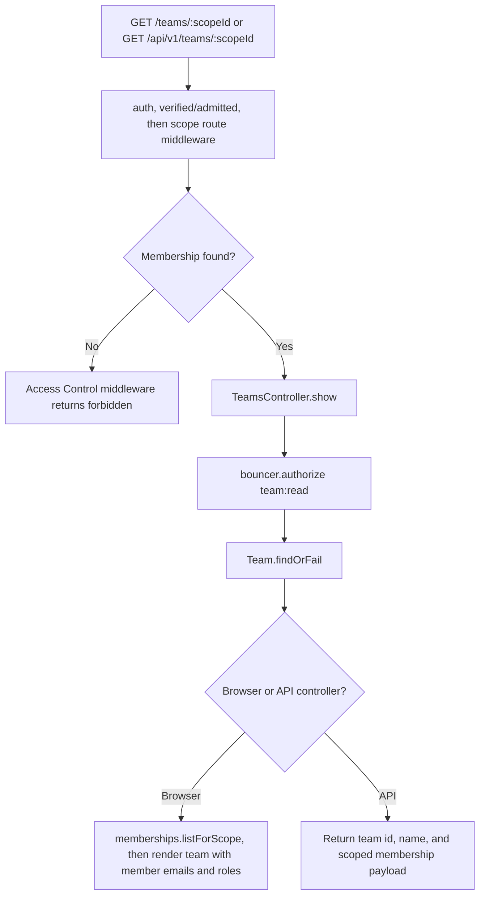

# US-TEAM-06 — Open a team

As a team member, I want to open a team I belong to so that I can see its name, my role, and the member information available in my kit.

**Status:** Current; source-reviewed, not runtime-tested here.
**Access:** Browser kits require a verified effective account. API requires an admitted account; `session` strategy uses raw `web`, while `access_tokens` uses `api_effective`. All routes scope membership before the controller.
**Entry:** Browser kits: `GET /teams/:scopeId`; API: `GET /api/v1/teams/:scopeId`.
**Documentation:** [Masquerade and team scope guide](../../docs/cookbook/masquerade-with-access-control.md#resolve-team-membership-for-the-effective-account).
**Source:** [Hypermedia team routes](../../apps/hypermedia/start/routes.ts), [API team routes](../../apps/api/start/routes.ts).
**Coverage:** [Team functional tests](../../apps/api/tests/functional/teams.spec.ts); this link identifies source behavior coverage, not runtime verification of these docs.

## Acceptance criteria

- There are no editable fields; a member follows a team link or requests the team scope ID.
- Route authentication and account admission/verification run before `scope()` loads the caller's membership. A nonmember receives the Access Control refusal before `TeamsController.show` runs.
- The controller requires `team:read`. A team member with the viewer role or above can open the team; a missing permission refuses the request.
- Browser page returns the team and up to 100 membership rows with member email and role, plus the caller's membership role. API returns the team `id`, `name`, and caller membership payload; it does not return the browser member listing.
- Browser effective identity resolves to the target during support mode. API session strategy remains raw-web identity; API token strategy resolves effective identity. A safe GET does not require the API context header used for writes.

## User flow

## Code flow

**Code references:** [Hypermedia team routes](../../apps/hypermedia/start/routes.ts), [Hypermedia controller](../../apps/hypermedia/app/controllers/teams_controller.ts), [API team routes and strategy guard](../../apps/api/start/routes.ts), [API strategy selection](../../apps/api/app/services/auth_strategy.ts), [API controller](../../apps/api/app/controllers/teams_controller.ts), [Masquerade access-control guide](../../docs/cookbook/masquerade-with-access-control.md), [Team functional tests](../../apps/api/tests/functional/teams.spec.ts), [Inertia React controller](../../apps/inertia-react/app/controllers/teams_controller.ts), [Inertia Vue controller](../../apps/inertia-vue/app/controllers/teams_controller.ts).
